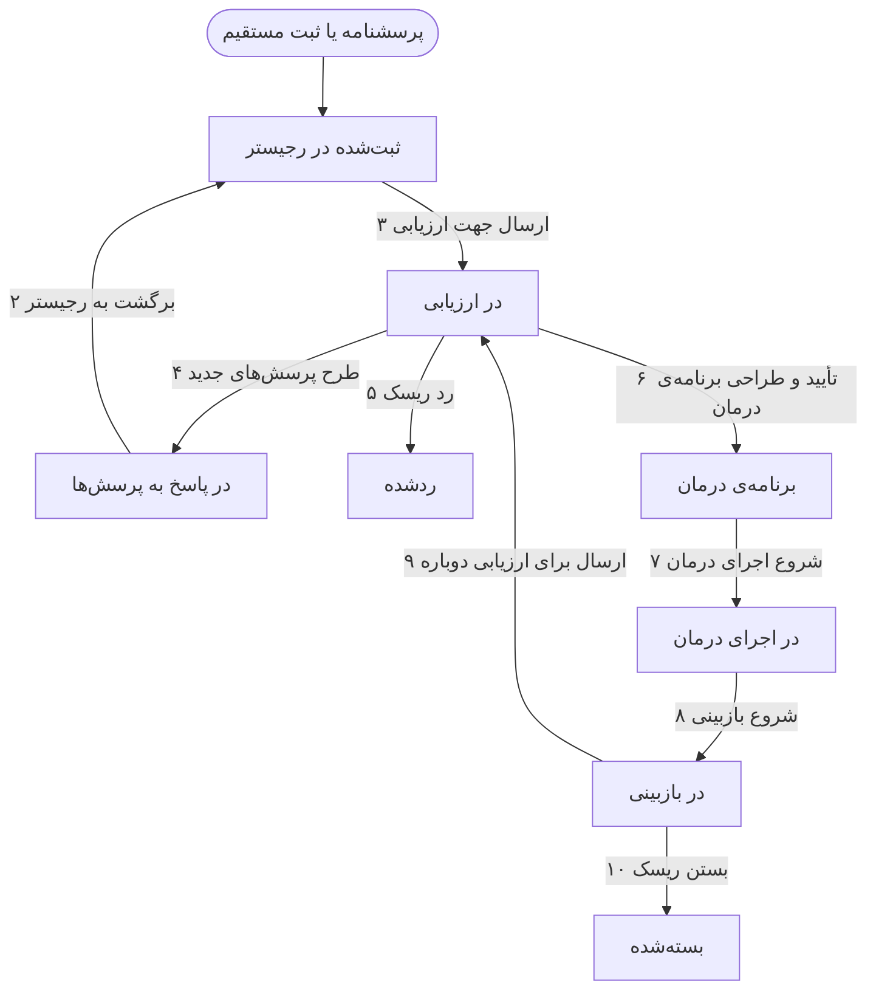
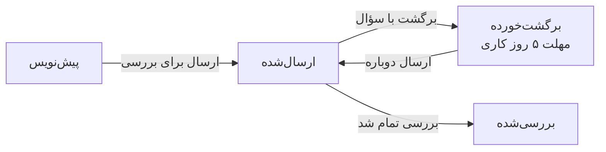
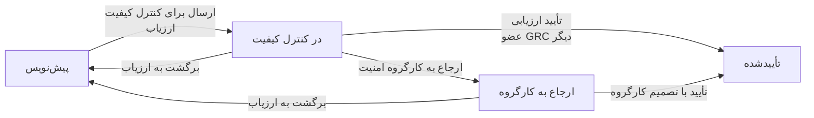
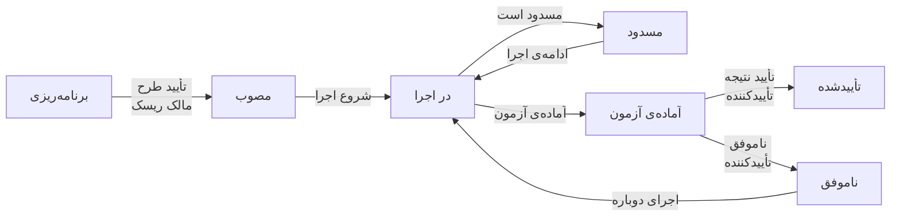
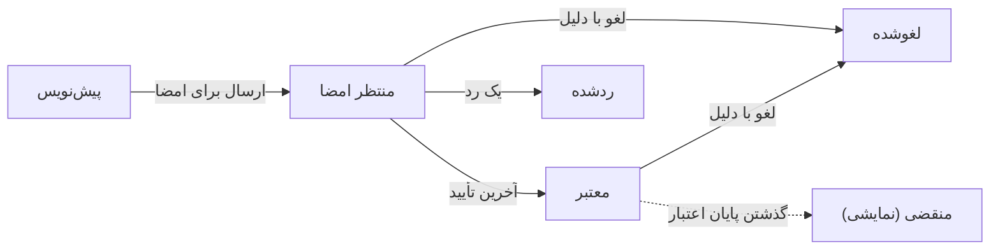

# راهنمای جامع کاربران سامانه‌ی مدیریت ریسک سازمانی (ERM)

> **مبنای این راهنما:** کد مخزن `R4ad/erm` تا شاخه‌ی رابط React (PR شماره‌ی ۲۳)، که روی PR رفع اشکال (شماره‌ی ۲۲) و قدم‌های ۱۰ تا ۲۱ سوار است؛ ۱۳ آبان ۱۴۰۵.
> همه‌ی قاعده‌ها، نام دکمه‌ها و پیام‌ها از خود کد آمده‌اند. هر جا قابلیتی هنوز ساخته نشده، صریح گفته شده است (بخش ۱۴).

---

## فهرست

1. [این راهنما برای کیست و چطور بخوانیم](#۱-این-راهنما-برای-کیست-و-چطور-بخوانیم)
2. [سامانه در یک نگاه](#۲-سامانه-در-یک-نگاه)
3. [مفاهیم و واژه‌ها](#۳-مفاهیم-و-واژهها)
4. [ورود، رابط کاربری و قراردادهای مشترک](#۴-ورود-رابط-کاربری-و-قراردادهای-مشترک)
5. [نقش‌ها و دسترسی‌ها](#۵-نقشها-و-دسترسیها)
6. [چرخه‌ی عمر ریسک](#۶-چرخهی-عمر-ریسک)
7. [گردش‌کارها، گام‌به‌گام](#۷-گردشکارها-گامبهگام)
8. [اطلاعات پایه و پیکربندی](#۸-اطلاعات-پایه-و-پیکربندی)
9. [راهنمای هر نقش](#۹-راهنمای-هر-نقش)
10. [یک مثال کامل، از پرسشنامه تا بستن ریسک](#۱۰-یک-مثال-کامل-از-پرسشنامه-تا-بستن-ریسک)
11. [جدول‌های مرجع](#۱۱-جدولهای-مرجع)
12. [پرسش‌های پرتکرار و رفع اشکال](#۱۲-پرسشهای-پرتکرار-و-رفع-اشکال)
13. [نکته‌های فنی برای مدیر سامانه](#۱۳-نکتههای-فنی-برای-مدیر-سامانه)
14. [آنچه هنوز ساخته نشده](#۱۴-آنچه-هنوز-ساخته-نشده)
15. [پیوست: نشانی صفحه‌ها](#۱۵-پیوست-نشانی-صفحهها)

---

## ۱. این راهنما برای کیست و چطور بخوانیم

این راهنما برای همه‌ی کاربران سامانه نوشته شده است: مدیران واحد، کارشناسان ریسک (عضو GRC)، اعضای کارگروه و کمیته‌ی امنیت، ممیزها، مدیر سامانه، و هر کسی که مالک یک ریسک یا مجری یک اقدام است.

- اگر تازه‌کارید، بخش ۲ (نمای کلی)، بخش ۴ (کار با رابط) و بخش ۹ (راهنمای نقش خودتان) را بخوانید.
- اگر می‌خواهید بدانید یک کار مشخص چطور انجام می‌شود، به بخش ۷ بروید. هر زیربخش آن یک گردش کار کامل است: چه کسی، از کجا، با چه شرط‌هایی.
- اگر دکمه‌ای را نمی‌بینید یا سامانه کاری را رد می‌کند، بخش ۱۲ (پرسش‌های پرتکرار) را ببینید. تقریباً همیشه علت یکی از شرط‌های همان کار است و سامانه آن را در صفحه نوشته است.
- عددها و جدول‌های روش ارزیابی (مهلت‌ها، سقف پذیرش، جدول احتمال) در بخش ۱۱ آمده‌اند.

در این راهنما، مسیر منو این‌طور نوشته می‌شود: **منو › ریسک‌ها › رجیستر ریسک**. نام دکمه‌ها و وضعیت‌ها همان‌طور که در صفحه دیده می‌شوند داخل «» آمده‌اند.

---

## ۲. سامانه در یک نگاه

سامانه‌ی مدیریت ریسک سازمانی یک سامانه‌ی تحت وب برای شناسایی، ثبت، ارزیابی، تصمیم‌گیری و پیگیری ریسک‌های خدمات و فرایندهای سازمان است. سامانه روی سرور داخلی اجرا می‌شود، رابطش فارسی و راست‌چین است و همه‌ی تاریخ‌ها شمسی‌اند. روش ارزیابی همان سند v5 است و همه‌ی عددها و جدول‌هایش در «نسخه‌ی روش» نگه داشته می‌شوند، نه در کد.

### مسیر اصلی یک ریسک

به زبان ساده:

1. **شناسایی:** مدیران واحد به پرسشنامه‌ی شناسایی جواب می‌دهند، یا کارشناس ریسک در مصاحبه جواب‌ها را ثبت می‌کند. جواب‌هایی که نشانه‌ی ریسک‌اند «ریسک در انتظار» می‌سازند. عضو GRC هم می‌تواند ریسک را مستقیم در رجیستر ثبت کند.
2. **ثبت و تکمیل:** عضو GRC هر ریسک در انتظار را به ریسک «ثبت‌شده در رجیستر» تبدیل یا کنار می‌گذارد، و اطلاعات ریسک (خدمت، بانک‌ها، مالک، عامل آغازگر، دامنه و شواهد) را کامل می‌کند.
3. **ارزیابی:** کارگروه امنیت ریسک را به ارزیابی می‌فرستد. عضو GRC در جلسه‌ی کارگروه ارزیابی را ثبت می‌کند: احتمال (A و مسیرهای تحقق و اثربخشی کنترل‌ها) و پروفایل پیامد برای داتین و هر بانک. موتور محاسبه امتیاز و سطح را می‌دهد.
4. **کنترل کیفیت و تصمیم:** عضو GRC دیگری ارزیابی را کنترل و تأیید می‌کند. کارگروه امنیت ریسک را رد می‌کند یا برای طراحی برنامه‌ی درمان تأیید می‌کند.
5. **طرح مواجهه:** عضو GRC گزینه‌ی مواجهه (کاهش، اجتناب، انتقال یا پذیرش) و اقدام‌ها را می‌نویسد و خود مالک ریسک طرح را تأیید می‌کند.
6. **اجرا:** مالک و مجری هر اقدام پیشرفت را ثبت می‌کنند و تأییدکننده‌ی نتیجه خروجی را با معیار قبولی می‌سنجد.
7. **بازبینی و بازسنجی:** ریسک دوباره ارزیابی می‌شود و نتیجه با ارزیابی مبنا و ارزیابی هدف مقایسه می‌شود. تصمیم این دور یا ادامه‌ی اصلاح است یا پذیرش ریسک باقیمانده.
8. **پذیرش یا بستن:** پذیرش ریسک باقیمانده همیشه زمان‌دار است و امضای صاحبان اختیار را می‌خواهد. ریسکی که دیگر وجود ندارد با دلیل بسته می‌شود.

### بخش‌های سامانه

| بخش | چه کاری می‌کند |
|---|---|
| کارهای من | فهرست شخصی هر کاربر از کارهایی که منتظر خود اوست؛ صفحه‌ی اول سامانه |
| رجیستر ریسک | فهرست همه‌ی ریسک‌ها با فیلتر، و پرونده‌ی هر ریسک |
| کتابخانه‌ی سناریو | الگوهای عمومی ریسک که ریسک‌ها از رویشان ساخته می‌شوند |
| شواهد | سندهایی که سطح یا وضعیت ریسک‌ها را پشتیبانی می‌کنند |
| ادغام و تفکیک | پیشنهادهای ادغام یا تفکیک ریسک و تصمیم مالک |
| جهان ریسک و دسته‌ها | جدول پوشش «خدمت × دسته‌ی ریسک» و هشت دسته‌ی T1 تا T8 |
| پرسشنامه | تعریف پرسشنامه، پاسخ مدیران واحد، بررسی پاسخ‌ها و پرسش‌های ریسک |
| ارزیابی‌ها | ارزیابی ذاتی، جاری و هدف با موتور محاسبه، کنترل کیفیت و مقایسه |
| کنترل‌ها | کتابخانه‌ی کنترل، ارزیابی اثربخشی (E) و بیانیه‌ی کاربردپذیری پیوست A |
| اقدامات | طرح مواجهه، اقدام‌ها، پذیرش زمان‌دار و بازسنجی |
| خدمات و دارایی‌ها | خدمات و فرایندها، بانک‌ها و زمان‌های بازیابی، تعهدها، دارایی‌ها، تأمین‌کنندگان و وابستگی‌ها |
| روش ارزیابی | نسخه‌ی فعال روش با همه‌ی مقیاس‌ها و جدول‌ها، و نسخه‌های قبلی |
| ساختار سازمانی | درخت واحدها و مدیرانشان |
| مدیریت سامانه | کاربران، ورود کارکنان از Excel، تعطیلات و سوابق ممیزی |

---

## ۳. مفاهیم و واژه‌ها

### موجودیت‌ها

| واژه | معنی در سامانه | کد |
|---|---|---|
| **خدمت یا فرایند** | چیزی که سازمان ارائه یا اجرا می‌کند، با یک واحد مالک و یک مالک خدمت. ریسک‌ها روی خدمت ثبت می‌شوند. | کد دستی |
| **بانک (مشتری)** | مشتری‌ای که خدمت به او ارائه می‌شود. «مشتری کلیدی» و «مبنای مالی» (ریال) روی بانک است. | بدون کد |
| **سناریوی مرجع** | الگوی عمومی یک ریسک (رویداد، شرایط، پیامد) که به خدمت یا بانک خاصی بسته نیست. با هر «تغییر اساسی» نسخه‌اش یکی بالا می‌رود. | `SC-0012` |
| **ریسک** | کاربرد یک سناریو در یک خدمت، بانک و دامنه‌ی مشخص، با یک مالک. ریسک بدون سناریو «مورد جدید» است. | `RK-1405-0012` |
| **ریسک در انتظار** | پیشنهاد ریسکی که از جواب پرسشنامه آمده و هنوز عضو GRC تکلیفش را روشن نکرده است. | - |
| **شاهد** | سندی که سطح یا وضعیت ریسک را پشتیبانی می‌کند: رخداد، آمار، آزمون، BIA یا قرارداد، تهدید یا آسیب‌پذیری، مصاحبه. | `EV-1405-0007` |
| **کنترل** | سازوکار مشخصی که ریسک‌ها به آن تکیه دارند: پیشگیرانه، کشف، مهار یا بازیابی. | `CT-0007` |
| **ارزیابی اثربخشی کنترل** | آزمون یک کنترل در یک دامنه که سطح E آن را تعیین می‌کند. | `CA-1405-0001` |
| **ارزیابی** | سنجش ریسک با نسخه‌ی روش: ذاتی، جاری یا هدف. | `AS-1405-0003` |
| **طرح مواجهه** | تصمیم مواجهه برای یک ارزیابی جاری تأییدشده: گزینه، دلیل و اقدام‌ها. | - |
| **اقدام** | کار مشخص با خروجی قابل آزمون، مالک، مجری، تأییدکننده و سررسید. | `TR-1405-0005` |
| **پذیرش ریسک** | پذیرش زمان‌دار ریسک باقیمانده با امضای صاحبان اختیار. | `AC-1405-0002` |
| **بازسنجی** | مقایسه‌ی نتیجه‌ی ارزیابی تازه با ارزیابی مبنا و هدف یک طرح، و تصمیم دور بعد. | - |

کدهای سال‌دار با سال شمسی ثبت ساخته می‌شوند و شماره‌ی هر سال از یک شروع می‌شود. کدی که یک بار داده شده دوباره داده نمی‌شود.

### نمادهای روش ارزیابی

| نماد | نام | توضیح کوتاه |
|---|---|---|
| **A** | عامل آغازگر | عامل شروع سناریو با چه فراوانی یا چه شواهدی رخ می‌دهد (۱ تا ۵). |
| **B0** | قابلیت پایه‌ی مسیر | یک مسیر تحقق، بدون اعتبار دادن به کنترل‌ها، چقدر ممکن است (۱ تا ۵). |
| **E** | اثربخشی کنترل | سطح ۱ تا ۵ هر کنترل، با احراز همه‌ی شرط‌های آن سطح. |
| **Bc** | اعتبار موانع پیشگیرانه | از E کنترل‌های پیشگیرانه‌ی یک مسیر و قاعده‌های Bc می‌آید (۱ تا ۵). |
| **B** | امکان تحقق | B هر مسیر کمترِ B0 و Bc است و B سناریو بیشترین B مسیرها. |
| **L** | احتمال نهایی | فقط از جدول A × B خوانده می‌شود (۱ تا ۵). |
| **I** | پیامد | بیشترین سطح پیامد بین پنج بُعد و همه‌ی ذی‌نفعان (داتین و هر بانک)، ۰ تا ۵. |
| **S، D، F، C، R** | ابعاد پیامد | خدمت و تداوم، داده و تمامیت، مالی، تعهدات و انطباق، اعتبار و رابطه‌ی مشتری. |
| **امتیاز** | L × I | از ۱ تا ۲۵. اگر ورودی بازه باشد، امتیاز هم بازه است و تصمیم بر کران بالا گرفته می‌شود. |
| **سطح پایه** | سطح امتیاز | پایین، متوسط، بالا یا بحرانی، از مرزهای نسخه‌ی روش. |
| **سطح تصمیم** | سطح نهایی | سطح پایه، مگر کف پیامد یا قاعده‌ی تقدم سطح بالاتری بخواهد. |
| **اطمینان کل** | کم، متوسط، زیاد | کمترین اطمینان مؤلفه‌هایی که نتیجه را تعیین کرده‌اند. |
| **ناقص** | ارزیابی ناقص | جزء نامعلومی دارد که می‌تواند نتیجه را بالاتر ببرد. پذیرش عادی را مسدود می‌کند. |
| **قاعده‌ی تقدم** | سه نشان روی ارزیابی | «رویداد در حال وقوع»، «منع الزام‌آور» و «عبور از حد تحمل مشتری». |

### سه نوع ارزیابی

| نوع | معنی | کی ثبت می‌شود | نکته |
|---|---|---|---|
| **ذاتی** | ریسک با کنار گذاشتن کنترل‌های مشخص | ریسک «در ارزیابی» است | کنترل‌های کنارگذاشته را در «فرض‌ها» بنویسید. |
| **جاری** | وضعیت امروز؛ مبنای تصمیم | ریسک «در ارزیابی» است | «سطح فعلی ریسک» سطح تصمیم آخرین ارزیابی جاری تأییدشده است. |
| **هدف** | پیش‌بینی بعد از اقدام | ریسک «در ارزیابی» یا «برنامه‌ی درمان» است | اقدام و معیار آزمونش را در «فرض‌ها» بنویسید. گزینه‌ی کاهش آن را لازم دارد. |

### اصل‌هایی که در همه‌ی سامانه برقرارند

- **هیچ رکورد مهمی حذف نمی‌شود.** خدمت، بانک، دارایی، کنترل، سناریو و دسته غیرفعال می‌شوند؛ ریسک رد یا بسته یا ادغام می‌شود؛ رابطه‌ها و تعهدها با «اعتبار تا» بسته می‌شوند. شاهد، پیوست، نظر، ارزیابی، پذیرش و هر ردیف تاریخچه می‌ماند. فقط دو استثنا هست: تعطیلی ثبت‌شده، و مسیر تحقق در ارزیابی پیش‌نویس.
- **هر تغییری با کاربر و زمان ثبت می‌شود.** تاریخچه‌ی تغییرات (simple-history) مقدار همه‌ی فیلدها را نگه می‌دارد و در «سوابق ممیزی › تغییرات داده» دیده می‌شود.
- **ارزیابی تأییدشده قفل است.** ارزیابی بعدی همیشه ردیف تازه است و روی قبلی نمی‌نویسد.
- **دسترسی از روی واحد و مالک است.** هر کس فقط چیزهایی را می‌بیند که اجازه دارد. رکوردی که اجازه‌ی دیدنش را ندارید اصلاً پیدا نمی‌شود (خطای ۴۰۴)، تا وجودش هم لو نرود.
- **سامانه شرط‌ها را خودش چک می‌کند و می‌گوید چه کم است.** هر انتقال یا تأییدی که شرطش برقرار نباشد، فهرست کمبودها را به زبان کاربر نشان می‌دهد.

---

## ۴. ورود، رابط کاربری و قراردادهای مشترک

### ورود و خروج

- نشانی سامانه را باز کنید و با **نام کاربری و رمز** وارد شوید. نام کاربری کارکنانی که از فایل منابع انسانی وارد شده‌اند همان **کد پرسنلی** است و رمز را مدیر سامانه می‌گذارد. ورود با Active Directory برنامه‌ی آینده است.
- نشست ۸ ساعت اعتبار دارد و با بستن مرورگر تمام می‌شود.
- خروج با دکمه‌ی «خروج» کنار نام شما در منوست.
- ورود، خروج و ورود ناموفق در سوابق ممیزی ثبت می‌شوند.

### دو رابط: صفحه‌های فعلی و رابط تازه

سامانه الان دو رابط دارد که هر دو از یک داده و یک قاعده‌ی دسترسی استفاده می‌کنند:

| | صفحه‌های فعلی (کلاسیک) | رابط تازه (React) |
|---|---|---|
| نشانی | `/` | `/app/` |
| رفتن از یکی به دیگری | دکمه‌ی «رابط تازه» بالای صفحه | پیوندهای منو با نشانه‌ی «صفحه‌ی فعلی»، و دکمه‌ی «پرونده در صفحه‌های فعلی» |
| صفحه‌ها | همه‌ی صفحه‌ها | «کارهای من»، «رجیستر ریسک»، «پرونده‌ی ریسک»، «پاسخ به سؤال‌ها» (فهرست، شروع، پاسخ و ارسال) و «پرسش‌های ریسک» |

در رابط تازه، هر کاری که هنوز به React منتقل نشده (مثلاً انتقال‌های گردش کار، ثبت ارزیابی، طرح مواجهه یا شاهد تازه) پیوندی به صفحه‌ی کلاسیک همان کار است و این را با نشانه و عنوان «در صفحه‌های فعلی سامانه باز می‌شود» می‌گوید. ویژگی‌های رابط تازه:

- مهلت هر کار با کلمه نوشته می‌شود («۳ روز مانده»، «۲ روز گذشته») و فقط مهلت گذشته قرمز است.
- همه‌ی رقم‌ها فارسی‌اند، جز کد رکوردها (مثل `RK-1405-0012`) که لاتین می‌ماند تا با جست‌وجو یکی باشد.
- پرونده‌ی ریسک مثل نامه‌ی اداری است: بلوک «شماره / تاریخ / پیوست» بالای برگه و وضعیت به شکل مهر.
- روی گوشی منو جمع می‌شود و با دکمه‌ی «منو» باز می‌شود. جدول‌ها ردیف‌به‌ردیف نشان داده می‌شوند.
- اگر نشست تمام شود، به صفحه‌ی ورود می‌روید و بعد از ورود به همان صفحه برمی‌گردید.

### منوی اصلی

منو در هر دو رابط یک محتوا دارد (در رابط تازه گروه‌بندی کمی متفاوت است):

| گروه | پیوندها |
|---|---|
| کار روزانه | کارهای من، پاسخ به سؤال‌ها |
| ریسک‌ها | رجیستر ریسک، کتابخانه‌ی سناریو، شواهد، ادغام و تفکیک، جهان ریسک، دسته‌های ریسک |
| پرسشنامه | پاسخ به سؤال‌ها، پرسش‌های ریسک، پاسخ‌ها و بررسی، تعریف پرسشنامه‌ها |
| کنترل‌ها | کتابخانه‌ی کنترل، بیانیه‌ی کاربردپذیری (فقط برای نقش‌هایی که آن را می‌بینند) |
| اقدامات | کارهای من، اقدام‌ها، پذیرش‌های ریسک |
| خدمات و دارایی‌ها | خدمات، تعهدها، دارایی‌ها، تأمین‌کنندگان، بانک‌ها |
| تکی | روش ارزیابی، ساختار سازمانی |
| مدیریت سامانه | کاربران، ورود کارکنان، تعطیلات (فقط مدیر سامانه)؛ سوابق ممیزی (مدیر سامانه و فقط مشاهده) |

پیوند «گزارش‌ها» در منوی کلاسیک هنوز جایی نمی‌رود (بخش ۱۴). نام شما و نقش‌هایتان کنار دکمه‌ی خروج دیده می‌شود.

### کارهای من

صفحه‌ی اول سامانه «کارهای من» است: فهرست کارهایی که الان منتظر خود شماست. هر بخش فقط وقتی دیده می‌شود که چیزی در آن باشد. اگر هیچ بخشی پر نباشد، پیام «الان کاری منتظر شما نیست» می‌آید.

| بخش | چه چیزی در آن می‌آید | برای چه کسی |
|---|---|---|
| اقدام‌های من | اقدام‌هایی که مالک یا مجری آن‌ها هستید و هنوز «تأییدشده» نیستند | مالک و مجری اقدام |
| منتظر تأیید نتیجه‌ی شما | اقدام‌هایی که «آماده‌ی آزمون» شده‌اند | تأییدکننده‌ی نتیجه‌ی اقدام |
| طرح‌های مواجهه‌ی منتظر تأیید شما | طرح یا اقدام تازه‌ای که تأیید مالک ریسک را می‌خواهد | مالک ریسک |
| طرح‌هایی که همه‌ی اقدام‌هایشان تأیید شده است | ریسک‌های «در اجرای درمان» که آماده‌ی بازبینی‌اند | عضو GRC و مدیر سامانه |
| پذیرش‌های منتظر امضای شما | پذیرش‌هایی که یکی از امضاهای باقیمانده با شماست | مالک ریسک، مدیر واحد، کمیته امنیت، عضو GRC |
| پذیرش‌های رو به انقضا | پذیرش‌های معتبری که تا ۳۰ روز دیگر تمام می‌شوند یا تمام شده‌اند | مسئول پیگیری پذیرش؛ عضو GRC همه را |
| ریسک‌های منتظر طرح مواجهه | ریسک‌های «برنامه‌ی درمان» با حال طرحشان: «بدون طرح»، «منتظر تأیید مالک»، «آماده‌ی شروع اجرا»، «منتظر بازسنجی طرح قبلی»؛ به ترتیب سطح، امتیاز و مهلت | عضو GRC و مدیر سامانه |
| ارزیابی‌های منتظر کنترل کیفیت شما | ارزیابی‌هایی که شما می‌توانید کنترل کنید (ارزیابشان نیستید) | عضو GRC و مدیر سامانه |
| اختلاف‌های ارجاع‌شده به کارگروه امنیت | ارزیابی‌هایی که تصمیم کارگروه را می‌خواهند و شما طرف اختلاف نیستید | کارگروه امنیت، عضو GRC، مدیر سامانه |
| درخواست‌های ادغام و تفکیک منتظر تأیید شما | پیشنهادهای باز روی ریسک‌های شما | مالک ریسک |
| پرسش‌های ریسک منتظر جواب | پرسش‌های باز روی ریسک‌های واحدهای تحت مدیریت شما | مدیر واحد |

### قراردادهای مشترک صفحه‌ها

- **تاریخ شمسی:** همه‌ی تاریخ‌ها شمسی نشان داده و گرفته می‌شوند، به شکل `1405/08/13`. رقم فارسی هم پذیرفته می‌شود، ولی سال دورقمی نه. با کلیک روی فیلد تاریخ، تقویم شمسی باز می‌شود که پنجشنبه و جمعه را قرمز نشان می‌دهد.
- **جست‌وجو و فیلتر:** هر فهرست فرم فیلتر دارد. با تایپ در جست‌وجو، بعد از لحظه‌ای فقط جدول نتایج عوض می‌شود و نشانی صفحه هم به‌روز می‌شود، پس می‌توانید نشانی فهرست فیلترشده را برای دیگران بفرستید. هر صفحه‌ی فهرست ۲۵ ردیف دارد (سوابق ممیزی ۵۰).
- **فرم‌ها:** همه‌ی فرم‌های افزودن و ویرایش یک شکل دارند، با دکمه‌ی «انصراف» که به صفحه‌ی قبل برمی‌گردد. فهرست کشویی واحدها به شکل درخت است تا واحدهای هم‌نام از هم جدا شوند.
- **پیام‌ها:** نتیجه‌ی هر کار بالای صفحه می‌آید. وقتی شرطی برقرار نیست، سامانه فهرست کمبودها را می‌نویسد.
- **دسترسی:** صفحه‌ای که نقش شما اجازه نمی‌دهد صفحه‌ی «دسترسی ندارید» (۴۰۳) را نشان می‌دهد و همین تلاش در سوابق ممیزی ثبت می‌شود.
- **پیوست:** به ریسک، شاهد، کنترل، ارزیابی اثربخشی، طرح، اقدام و پذیرش فایل پیوست می‌شود: حداکثر ۲۰ مگابایت، فقط PDF، تصویر (PNG، JPG، GIF)، Word، Excel، PowerPoint، متن و CSV. محتوای فایل هم با پسوندش چک می‌شود. دانلود همیشه از راه سامانه و بعد از چک دسترسی است. پیوست حذف نمی‌شود.
- **نظر:** هر کس رکوردی را می‌بیند زیر آن نظر می‌گذارد. نظر را فقط نویسنده‌اش ویرایش می‌کند و متن قبلی در تاریخچه می‌ماند. نظر حذف نمی‌شود. روی ریسک ردشده یا بسته‌شده هم نظر گذاشتن آزاد است.

---

## ۵. نقش‌ها و دسترسی‌ها

### دو نوع نقش

سامانه دو جور «نقش» دارد:

1. **نقش سازمانی:** شش نقش که مدیر سامانه به هر کاربر می‌دهد. یک کاربر می‌تواند چند نقش داشته باشد.
2. **نقش موقعیتی:** وقتی کسی در یک رکورد مشخص جایگاهی دارد، مثل مالک ریسک یا مجری اقدام. این نقش را کسی جداگانه نمی‌دهد؛ از خود رکورد می‌آید و کارهای خودش را دارد، هر نقش سازمانی‌ای که آن شخص داشته باشد.

#### شش نقش سازمانی

| نقش | کیست | خلاصه‌ی کار |
|---|---|---|
| **مدیر سامانه** | مسئول فنی و اداری سامانه (کاربر superuser هم مدیر سامانه است) | کاربران، واحدها، تعطیلات، نسخه‌ی روش؛ و هر کاری که عضو GRC می‌کند، و همه‌ی انتقال‌های گردش کار |
| **عضو GRC** | کارشناس ریسک و متولی روش | تعریف پرسشنامه، بررسی پاسخ‌ها، ثبت و ویرایش ریسک، ثبت ارزیابی، کنترل کیفیت، طرح مواجهه، پذیرش، بازسنجی؛ و ثبت اطلاعات پایه |
| **کارگروه امنیت** | کارگروه ریسک | ارسال ریسک به ارزیابی، رد یا تأیید ریسک بعد از ارزیابی، تصمیم درباره‌ی اختلاف‌های کنترل کیفیت، ثبت وضعیت جهان ریسک |
| **کمیته امنیت** | صاحب اختیار ریسک‌های بالا و بحرانی | امضای پذیرش ریسک‌های بالا و بحرانی با شماره یا تاریخ صورت‌جلسه |
| **مدیر واحد** | مدیر یک یا چند واحد سازمانی | جواب پرسشنامه و پرسش‌های ریسک برای واحدهای خودش، امضای پذیرش سطح متوسط |
| **فقط مشاهده** | ممیز | دیدن همه چیز (یا فقط دامنه‌اش)، سوابق ممیزی و خروجی Excel؛ هیچ تغییری نمی‌دهد |

#### نقش‌های موقعیتی

| نقش | از کجا می‌آید | کارهای خاص |
|---|---|---|
| **مالک ریسک** | فیلد «مالک ریسک» | همیشه ریسک‌های خودش را می‌بیند؛ طرح مواجهه و اقدام‌های تازه را تأیید می‌کند؛ پذیرش را همیشه خودش امضا می‌کند؛ ادغام و تفکیک را تأیید یا رد می‌کند؛ برای ریسک خودش شاهد ثبت می‌کند؛ پذیرش را لغو می‌کند |
| **مالک اقدام و مجری اقدام** | فیلدهای «مالک» و «مجری» اقدام | اقدام را حتی بدون دیدن ریسک می‌بینند؛ شروع، مسدود، ادامه، آماده‌ی آزمون و اجرای دوباره؛ یادداشت پیشرفت؛ پیوست گزارش اجرا |
| **تأییدکننده‌ی نتیجه** | فیلد «تأییدکننده‌ی نتیجه» اقدام | تأیید یا رد نتیجه‌ی اقدام با توضیح؛ کسی جز مالک و مجری اقدام |
| **مسئول کنترل** | فیلد «مسئول» کنترل | کنترل خودش را می‌بیند؛ شاهد آزمون و پیوست را روی کنترل و ارزیابی اثربخشی آن می‌گذارد |
| **مالک خدمت یا دارایی** | فیلد «مالک» | خدمت یا دارایی خودش را می‌بیند |
| **مالک شاهد** | فیلد «مالک» شاهد | شاهد خودش را می‌بیند و ویرایش می‌کند، حتی محرمانه |
| **مسئول پیگیری پذیرش** | فیلد «مسئول پیگیری» | پذیرش‌های رو به انقضا را در «کارهای من» می‌بیند و به پذیرش پیوست می‌گذارد |
| **ارزیاب و کنترل‌کننده** | ثبت‌کننده و ارسال‌کننده‌ی ارزیابی | ارزیاب ارزیابی خودش را کنترل کیفیت نمی‌کند و در اختلاف آن تصمیم نمی‌گیرد |

### چه کسی چه چیزی را می‌بیند

قاعده‌ی پایه برای هر رکوردی که «واحد مالک» و «مالک» دارد (خدمت، دارایی، ریسک):

- **همه را می‌بینند:** مدیر سامانه، عضو GRC، کارگروه امنیت و کمیته امنیت.
- **مدیر واحد:** رکوردهای واحدهای تحت مدیریتش و همه‌ی زیرمجموعه‌هایشان.
- **مالک:** رکورد خودش را همیشه.
- **فقط مشاهده (ممیز):** همه را، مگر مدیر سامانه برایش «دامنه‌ی مشاهده» تعیین کرده باشد؛ آن‌وقت فقط همان واحدها و زیرمجموعه‌هایشان را.

| رکورد | چه کسی می‌بیند |
|---|---|
| بانک‌ها، تأمین‌کنندگان، کتابخانه‌ی سناریو، دسته‌ها، روش ارزیابی (نسخه‌ی فعال و بایگانی)، ساختار سازمانی | همه‌ی کاربران |
| خدمت | قاعده‌ی پایه |
| دارایی | قاعده‌ی پایه، به‌اضافه‌ی دارایی‌هایی که خدمت‌های قابل‌دیدن شما به آن‌ها وابسته‌اند |
| تعهد | هر کس دست‌کم یکی از خدمت‌هایش را ببیند؛ تعهد بدون خدمت فقط برای کسانی که همه را می‌بینند |
| جدول جهان ریسک | با قاعده‌ی خدمت |
| ریسک | قاعده‌ی پایه روی واحد و مالک خود ریسک |
| ارزیابی، طرح مواجهه، پذیرش، پیشنهاد ادغام و تفکیک | هر کس ریسکش را می‌بیند |
| اقدام | هر کس ریسکش را می‌بیند، به‌اضافه‌ی مالک، مجری و تأییدکننده‌ی خود اقدام |
| شاهد «عادی» | عضو GRC و مدیر سامانه؛ کارگروه و کمیته‌ی امنیت؛ هر کس یکی از ریسک‌های آن را می‌بیند؛ مالک شاهد |
| شاهد «محرمانه» | عضو GRC، مدیر سامانه، مالک شاهد، مالکان ریسک‌های آن، و ممیز در دامنه‌اش |
| کنترل و ارزیابی اثربخشی | مدیر سامانه، عضو GRC، کارگروه و کمیته‌ی امنیت و ممیز همه را؛ بقیه کنترل‌هایی که مسئولشان هستند یا ریسک‌های قابل‌دیدنشان به آن‌ها تکیه دارند |
| بیانیه‌ی کاربردپذیری | مدیر سامانه، عضو GRC، کارگروه و کمیته‌ی امنیت، ممیز |
| پاسخ پرسشنامه | پاسخ‌دهنده و ثبت‌کننده؛ مدیران واحد آن؛ نقش‌های «همه را می‌بیند»؛ ممیز در دامنه‌اش |
| پیش‌نویس روش و نسخه‌ی تصویب‌شده‌ی فعال‌نشده | مدیر سامانه، عضو GRC، کارگروه و کمیته‌ی امنیت، فقط مشاهده |
| سوابق ممیزی | مدیر سامانه و فقط مشاهده |
| کاربران، ورود کارکنان، تعطیلات | فقط مدیر سامانه |

### چه کسی چه کاری می‌کند

در جدول زیر، «مدیر سامانه» همه‌ی کارهای «عضو GRC» را هم انجام می‌دهد، جز جاهایی که صریح گفته شده (کنترل کیفیت ارزیابی خودش، و امضا یا تأیید به جای مالک ریسک).

| کار | چه کسی |
|---|---|
| ثبت و ویرایش بانک، خدمت، زمان‌های بازیابی، تعهد، دارایی، تأمین‌کننده، وابستگی | عضو GRC، مدیر سامانه |
| ثبت و ویرایش دسته‌ی ریسک | عضو GRC، مدیر سامانه |
| ثبت وضعیت خانه‌های جهان ریسک | عضو GRC، کارگروه امنیت، مدیر سامانه |
| ثبت و ویرایش سناریو، ریسک و پیوند بیرونی | عضو GRC، مدیر سامانه |
| تعریف پرسشنامه، سؤال و گزینه | عضو GRC، مدیر سامانه |
| ساختن و پر کردن پاسخ پرسشنامه | مدیر واحد برای واحدهای خودش؛ عضو GRC در مصاحبه به نام مدیر واحد |
| بررسی پاسخ: برگشت با سؤال، ریسک در انتظار تازه، ثبت در رجیستر، کنار گذاشتن، «بررسی تمام شد» | عضو GRC، مدیر سامانه |
| جواب پرسش ریسک | مدیر واحد ریسک (و بالادست‌ها)؛ عضو GRC به نام مدیر |
| ثبت شاهد | عضو GRC و مدیر سامانه برای هر ریسک فعال؛ مالک ریسک برای ریسک خودش |
| ویرایش شاهد | عضو GRC، مدیر سامانه، مالک شاهد |
| ثبت و ویرایش کنترل و بیانیه‌ی کاربردپذیری | عضو GRC، مدیر سامانه |
| ثبت ارزیابی اثربخشی کنترل (E) | عضو GRC، مدیر سامانه |
| پیوست شاهد آزمون به کنترل و ارزیابی اثربخشی | عضو GRC، مدیر سامانه، مسئول کنترل |
| انتقال‌های گردش کار ریسک | جدول بخش ۶ |
| ثبت و ویرایش ارزیابی ریسک و ارسال برای کنترل کیفیت | عضو GRC، مدیر سامانه |
| کنترل کیفیت ارزیابی | عضو GRC یا مدیر سامانه‌ای که ارزیاب همان پرونده نیست |
| ثبت تصمیم کارگروه در اختلاف | عضو کارگروه امنیت، عضو GRC یا مدیر سامانه‌ای که طرف اختلاف نیست |
| نوشتن طرح مواجهه و اقدام | عضو GRC، مدیر سامانه |
| تأیید طرح مواجهه و اقدام‌های تازه | فقط مالک ریسک |
| ثبت پیشرفت اقدام | مالک و مجری اقدام؛ عضو GRC و مدیر سامانه به جای آن‌ها |
| تأیید یا رد نتیجه‌ی اقدام | فقط تأییدکننده‌ی همان اقدام |
| نوشتن و ارسال پذیرش برای امضا | عضو GRC، مدیر سامانه |
| امضای پذیرش | مالک ریسک (همیشه)؛ مدیر خود واحد ریسک (متوسط و پذیرش غیرعادی)؛ کمیته امنیت (بالا و بحرانی)؛ عضو GRC به نیابت از مدیریت ارشد با نامه |
| لغو پذیرش | عضو GRC، مدیر سامانه، مالک ریسک |
| ثبت بازسنجی | عضو GRC، مدیر سامانه |
| پیشنهاد ادغام و تفکیک | عضو GRC، مدیر سامانه |
| تأیید یا رد ادغام و تفکیک | فقط مالک ریسک |
| کاربران، نقش‌ها، واحدهای تحت مدیریت، دامنه‌ی مشاهده، ورود کارکنان، واحد سازمانی، تعطیلات | مدیر سامانه |
| کپی، تصویب و فعال‌سازی نسخه‌ی روش | مدیر سامانه (به درخواست GRC، در پنل مدیریت) |
| دیدن سوابق ممیزی و خروجی Excel | مدیر سامانه، فقط مشاهده |

---

## ۶. چرخه‌ی عمر ریسک

### هشت وضعیت

| وضعیت | معنی | ریسک فعال است؟ |
|---|---|---|
| **ثبت‌شده در رجیستر** | ریسک ثبت شده و اطلاعاتش کامل می‌شود. هر ریسک تازه با این وضعیت به دنیا می‌آید. | بله |
| **در پاسخ به پرسش‌ها** | برای ارزیابی اطلاعات کم است و از واحد ریسک پرسش‌هایی پرسیده شده است. | بله |
| **در ارزیابی** | ریسک در دست کارگروه امنیت است و ارزیابی‌اش ثبت می‌شود. | بله |
| **ردشده** | کارگروه ریسک را رد کرده است. | خیر؛ فقط سابقه |
| **برنامه‌ی درمان** | کارگروه ریسک را تأیید کرده و طرح مواجهه نوشته و تأیید می‌شود. | بله |
| **در اجرای درمان** | اقدام‌های طرح اجرا می‌شوند. | بله |
| **در بازبینی** | اقدام‌ها انجام شده و ریسک بازبینی می‌شود. | بله |
| **بسته‌شده** | ریسک دیگر وجود ندارد، یا در ریسک دیگری ادغام شده است. | خیر؛ فقط سابقه |

ریسک «ردشده» یا «بسته‌شده» دیگر ویرایش نمی‌شود، شاهد و پیوست و پیوند بیرونی تازه نمی‌گیرد و ادغام یا تفکیک نمی‌شود. نظر گذاشتن روی آن آزاد است. ریسک هیچ‌وقت حذف نمی‌شود.

### نمودار انتقال‌ها

عددها شماره‌ی ردیف جدول چرخه‌ی عمر (جواب س۱۵) است. ردیف ۱ (پاسخ به پرسشنامه) و تبدیل جواب به ریسک در بخش پرسشنامه انجام می‌شود. ادغام تأییدشده هم ریسک فعال را از هر وضعیتی «بسته‌شده» می‌کند (بخش ۷٫۱۲).

### جدول انتقال‌ها

انتقال‌ها در کارت «گردش کار» بالای صفحه‌ی ریسک دیده می‌شوند. صفحه فقط انتقال‌هایی را نشان می‌دهد که از وضعیت فعلی و با نقش شما ممکن‌اند. اگر هیچ انتقالی نباشد، می‌نویسد «از وضعیت فعلی کاری با نقش شما نیست». مدیر سامانه همه‌ی انتقال‌ها را انجام می‌دهد.

| ردیف | دکمه | از | به | چه کسی | فیلدهای فرم | شرط‌ها |
|---|---|---|---|---|---|---|
| ۲ | «برگشت به رجیستر» | در پاسخ به پرسش‌ها | ثبت‌شده در رجیستر | عضو GRC | توضیح (اختیاری) | همه‌ی پرسش‌های ریسک جواب گرفته باشند. |
| ۳ | «ارسال جهت ارزیابی» | ثبت‌شده در رجیستر | در ارزیابی | کارگروه امنیت، عضو GRC | فرض قابل آزمون یا توضیح | شرح، خدمت، دست‌کم یک بانک و مالک فعال تعیین شده باشد، و یا شاهدی به ریسک وصل باشد یا فرض قابل آزمون نوشته شود. |
| ۴ | «طرح پرسش‌های جدید» | در ارزیابی | در پاسخ به پرسش‌ها | عضو GRC | پرسش‌ها (هر پرسش یک خط)، توضیح | دست‌کم یک پرسش. مهلت جواب هر پرسش ۵ روز کاری است. |
| ۵ | «رد ریسک» | در ارزیابی | ردشده | کارگروه امنیت، عضو GRC | تاریخ جلسه‌ی کارگروه، دلیل رد (اجباری) | - |
| ۶ | «تأیید و طراحی برنامه‌ی درمان» | در ارزیابی | برنامه‌ی درمان | کارگروه امنیت، عضو GRC | تاریخ جلسه‌ی کارگروه، توضیح | یک ارزیابی جاری تأییدشده با سطح تصمیم، که بعد از آخرین ورود ریسک به «در ارزیابی» تأیید شده باشد. |
| ۷ | «شروع اجرای درمان» | برنامه‌ی درمان | در اجرای درمان | عضو GRC | توضیح | طرح مواجهه‌ی ارزیابی فعلی ثبت شده و مالک ریسک آن و همه‌ی اقدام‌هایش را تأیید کرده باشد. |
| ۸ | «شروع بازبینی» | در اجرای درمان | در بازبینی | عضو GRC | توضیح | فعلاً شرطی ندارد؛ شرط موعد بازبینی بعداً اضافه می‌شود. |
| ۹ | «ارسال برای ارزیابی دوباره» | در بازبینی | در ارزیابی | عضو GRC | توضیح | - |
| ۱۰ | «بستن ریسک» | در بازبینی | بسته‌شده | عضو GRC | چرا این ریسک دیگر وجود ندارد (اجباری) | - |

هر انتقال با انجام‌دهنده، زمان، دلیل و تاریخ جلسه در **خط زمانی** پایین صفحه‌ی ریسک (و بخش «گردش کار» رابط تازه) ثبت می‌شود. ردیف خط زمانی ویرایش و حذف نمی‌شود. اگر دو نفر هم‌زمان انتقالی انجام دهند، دومی پیام «وضعیت ریسک در این فاصله عوض شده است» می‌گیرد.

---

## ۷. گردش‌کارها، گام‌به‌گام

### ۷٫۱ شناسایی ریسک با پرسشنامه

**چه کسانی:** عضو GRC (تعریف و بررسی)، مدیر واحد (جواب)، و عضو GRC در نقش مصاحبه‌گر.

#### گام ۱: تعریف پرسشنامه (عضو GRC)

1. **منو › پرسشنامه › تعریف پرسشنامه‌ها** و «پرسشنامه‌ی جدید». عنوان و «راهنمای پاسخ‌دهنده» را بنویسید. پرسشنامه‌ی تازه **غیرفعال** است.
2. در صفحه‌ی پرسشنامه، با «سؤال جدید» سؤال‌ها را اضافه کنید. هر سؤال: ترتیب، متن، راهنما، نوع، اجباری بودن و فعال بودن.
   - چهار نوع سؤال هست: **متن**، **بله و خیر**، **تک‌گزینه‌ای** و **چندگزینه‌ای**.
   - سؤال گزینه‌ای دست‌کم دو گزینه‌ی فعال می‌خواهد. برای بله و خیر دو گزینه خودکار ساخته می‌شود؛ فقط مشخص کنید کدام «نشانه‌ی ریسک» است.
   - گزینه‌ای که «نشانه‌ی ریسک» است می‌تواند به یک **سناریوی مرجع** و یک **دسته** وصل شود. این‌ها بعداً در ریسک در انتظار از پیش پر می‌شوند.
   - نوع سؤالی که جواب گرفته عوض نمی‌شود؛ سؤال تازه بسازید.
3. وقتی سؤال‌ها آماده شد، پرسشنامه را ویرایش و **فعال** کنید. فقط پرسشنامه‌ی فعال پاسخ تازه می‌گیرد. پرسشنامه، سؤال و گزینه حذف نمی‌شوند؛ غیرفعال می‌شوند.

#### گام ۲: جواب دادن (مدیر واحد)

1. **منو › کار روزانه › پاسخ به سؤال‌ها** (در رابط تازه یا کلاسیک). فهرست «پرسشنامه‌های فعال» و «پاسخ‌های من» را می‌بینید. اگر پرسش ریسکی منتظر شماست، بالای صفحه گفته می‌شود.
2. کنار پرسشنامه «شروع پاسخ» (رابط تازه) یا «پاسخ تازه» (کلاسیک) را بزنید و بگویید پاسخ برای **کدام واحد** و در صورت نیاز **کدام خدمت** است. بدون خدمت یعنی کل واحد.
   - فقط واحدهای تحت مدیریت شما و زیرمجموعه‌هایشان در فهرست‌اند، و خدمت باید مال همان واحد یا زیرمجموعه‌هایش باشد.
   - برای یک پرسشنامه، واحد و خدمت فقط یک پاسخ باز (پیش‌نویس، ارسال‌شده یا برگشت‌خورده) هست. اگر هست، همان را کامل کنید.
3. پاسخ این بخش‌ها را دارد:
   - **کارکردها و پرسش‌های جلسه:** سه تا پنج کارکرد اصلی و تعهدهای واحد، و هشت پرسش جلسه‌ی شناسایی: چه نتیجه‌ای لازم است، چه تعهد زمانی یا کیفی داریم، چه اتفاقی مانع می‌شود، در چه شرایطی ممکن می‌شود، چه کسی و چگونه آسیب می‌بیند، به چه افراد یا خدماتی وابسته‌ایم، چه شاهد یا تجربه‌ی تازه‌ای داریم، و امروز چه چیزی جلوی وقوع یا خسارت را می‌گیرد. لازم نیست نام تهدید یا فهرست دارایی را بدانید.
   - **سؤال‌ها:** سؤال‌های تعریف‌شده‌ی GRC. سؤال اجباری علامت «اجباری» دارد.
   - **مورد جدید:** هر ریسک دیگری که در سؤال‌ها نیامده، با شرح آزاد. الگو: «در خدمت یا فرآیند [نام]، به علت یا در شرایط [عامل و وضعیت]، ممکن است [رویداد مشخص] رخ دهد و انجام [هدف یا تعهد] برای [داتین یا مشتری] را مختل کند؛ پیامد قابل مشاهده‌ی آن [نوع و دامنه‌ی پیامد] است.»
4. هر وقت خواستید **«ذخیره‌ی پیش‌نویس»** را بزنید. رابط تازه نشان می‌دهد تغییرات ذخیره شده یا نه.
5. وقتی تمام شد، **«ارسال برای بررسی»**. اگر سؤال اجباری‌ای جواب نداشته باشد، جواب‌ها ذخیره می‌شوند ولی پاسخ ارسال نمی‌شود و صفحه به اولین سؤال بی‌جواب می‌رود.
6. با ارسال، برای هر گزینه‌ی «نشانه‌ی ریسک» که انتخاب کرده‌اید و برای «مورد جدید» یک **ریسک در انتظار** ساخته می‌شود. بعد از ارسال، پاسخ فقط وقتی دوباره ویرایش می‌شود که عضو GRC آن را برگرداند.

#### گام ۳: ثبت مصاحبه (عضو GRC)

عضو GRC می‌تواند جواب‌های یک جلسه‌ی مصاحبه را به نام مدیر واحد ثبت کند. همان «شروع پاسخ» را بزنید؛ برای شما یک فیلد اضافه هست: **پاسخ‌دهنده**، یعنی مدیر واحدی که در مصاحبه جواب داده است. همه‌ی واحدهای فعال در فهرست‌اند، ولی پاسخ‌دهنده باید مدیر همان واحد یا بالادست آن باشد. کانال این پاسخ «مصاحبه» است. تا پیش از ارسال، هم عضو GRC ثبت‌کننده و هم مدیر واحدی که پاسخ به نامش است آن را ویرایش می‌کنند.

#### گام ۴: بررسی پاسخ (عضو GRC)

1. **منو › پرسشنامه › پاسخ‌ها و بررسی** و دکمه‌ی **«صف بررسی (ارسال‌شده)»**. فیلترها: وضعیت، پرسشنامه، واحد، و «ریسک در انتظار: دارد یا ندارد».
2. پاسخ را باز کنید. در یک پاسخ ارسال‌شده این کارها را دارید:
   - **«برگشت با سؤال»:** یک سؤال مشخص بنویسید. پاسخ «برگشت‌خورده» می‌شود و پاسخ‌دهنده ۵ روز کاری مهلت دارد. بعد از مهلت، پاسخ «عقب‌افتاده» (مهلت گذشته) نشان داده می‌شود.
   - **«ریسک در انتظار تازه»:** از جواب‌های متنی دستی ریسک در انتظار بسازید (شرح، سناریو و دسته).
   - برای هر ریسک در انتظار:
     - **«ثبت در رجیستر»:** فرم ثبت ریسک با خدمت، واحد، سناریو، دسته، شرح و کانال ورود از پیش پر می‌شود. با ذخیره، ریسک «ثبت‌شده در رجیستر» ساخته می‌شود.
     - **«کنار گذاشتن»:** با دلیل، و اگر تکراری است با نشان دادن ریسک موجود.
   - **«بررسی تمام شد»:** وقتی ممکن است که تکلیف همه‌ی ریسک‌های در انتظار پاسخ روشن شده باشد. پاسخ «بررسی‌شده» می‌شود.

> ارسال دوباره بعد از برگشت، ریسک در انتظار تکراری نمی‌سازد. اگر «مورد جدید» تغییر کرده باشد، شرح ریسک در انتظار قبلی به‌روز می‌شود.

### ۷٫۲ ثبت مستقیم ریسک در رجیستر

**چه کسانی:** عضو GRC و مدیر سامانه. مدیر واحد ریسک را فقط از راه پرسشنامه پیشنهاد می‌دهد.

1. **منو › ریسک‌ها › رجیستر ریسک** و «ثبت ریسک تازه»، یا در صفحه‌ی یک خدمت «ثبت ریسک برای این خدمت».
2. فیلدها:

| فیلد | توضیح |
|---|---|
| سناریوی مرجع | اختیاری. خالی یعنی «مورد جدید». از سناریوی غیرفعال ریسک تازه ساخته نمی‌شود. |
| عنوان و شرح | شرح با الگوی «در اثر [علت یا شرط]، ممکن است [رویداد] رخ دهد که به [پیامد] برای [ذی‌نفع] منجر شود». |
| کانال ورود | مصاحبه، پرسشنامه، رخداد، تغییر، اسکن، ممیزی. |
| خدمت | پیش از تأیید ارزیابی اجباری است. |
| واحد | اگر خالی بماند، واحد مالک خدمت گذاشته می‌شود. |
| بانک‌های متأثر | دست‌کم یکی پیش از ارسال برای ارزیابی. |
| مالک ریسک | یک شخص حقیقی فعال؛ پیش از ارسال برای ارزیابی لازم است. |
| دسته‌ی اصلی | اگر خالی بماند، دسته‌ی سناریو گذاشته می‌شود. |
| برچسب‌ها | از همین فرم ساخته می‌شوند. |
| دامنه | محیط (تولید، آزمون، بازیابی) و مرز مسئولیت. |
| طبقه‌ی اطلاعات و برچسب CIA | فقط برای نشان دادن اهمیت؛ امتیاز نمی‌گیرند. |
| عامل آغازگر، واحد شمارش، موارد خارج از شمارش | تعریف آغازگر که در همه‌ی ارزیابی‌های ریسک ثابت است. |
| کنترل‌های فعلی | کنترل‌هایی که ریسک به آن‌ها تکیه دارد. کنترل غیرفعال برای ریسک تازه انتخاب نمی‌شود. |

3. چند رفتار خودکار:
   - **کد** با سال شمسی ساخته می‌شود، مثل `RK-1405-0012`.
   - **«نیازمند تکمیل»** تا وقتی عامل آغازگر، واحد شمارش یا دامنه نوشته نشده روشن می‌ماند و در رجیستر فیلتر دارد.
   - خانه‌ی **جهان ریسک** همان خدمت و دسته اگر «در انتظار» باشد «بررسی‌شده» می‌شود. ریسک در خانه‌ای که «نامرتبط» است ثبت نمی‌شود.
   - نسخه‌ی سناریو روی ریسک ثابت می‌ماند. اگر سناریو بعداً تغییر اساسی کند، صفحه‌ی ریسک هشدار می‌دهد که شرح را با سناریو مقایسه کنید.
4. در صفحه‌ی ریسک، **پیوندهای بیرونی** را با «افزودن پیوند» ثبت کنید: شناسه‌ی همین ریسک در سامانه‌ی تغییر، رخداد، مشکل، آسیب‌پذیری، قرارداد، تأمین‌کننده یا برنامه‌ی تداوم. یک شناسه با یک نوع فقط یک بار ثبت می‌شود. پیوند حذف نمی‌شود؛ پیوند اشتباه ویرایش می‌شود.

### ۷٫۳ کار با رجیستر و پرونده‌ی ریسک

**رجیستر ریسک** (هر دو رابط): جست‌وجو در کد، عنوان و شرح؛ فیلتر وضعیت، واحد (با زیرمجموعه‌ها)، دسته، خدمت، برچسب، کانال ورود و تکمیل. ستون‌ها: شماره، عنوان، سطح فعلی، وضعیت، مالک و تاریخ ثبت. فهرست خدمت‌ها در فیلتر فقط خدمت‌هایی است که شما می‌بینید.

**پرونده‌ی ریسک** این بخش‌ها را دارد:

| بخش | محتوا |
|---|---|
| گردش کار | دکمه‌های انتقال ممکن، «پیشنهاد ادغام» و «پیشنهاد تفکیک»، پیشنهاد باز و پیوندهای ادغام و تفکیک |
| مشخصات | سناریو، شرح، کانال، خدمت، واحد، بانک‌ها، مالک، دسته، برچسب‌ها، دامنه، طبقه‌ی اطلاعات، CIA، تعریف آغازگر |
| پیوندهای بیرونی | شناسه‌ها در سامانه‌های دیگر |
| پرسش‌های ارزیابی | پرسش‌های ردیف ۴ با مهلت و جواب (رابط تازه) |
| ارزیابی‌ها | همه‌ی ارزیابی‌ها با نوع، نسخه‌ی روش، افق، جلسه، وضعیت و سطح؛ «سطح فعلی ریسک»؛ انتخاب ۲ تا ۴ ارزیابی برای مقایسه |
| طرح مواجهه | طرح‌ها با ارزیابی مبنا، سطح، مهلت، تعداد اقدام و تأیید مالک؛ هشدار مهلت طرح و مهلت مهار؛ هشدار بازسنجی |
| پذیرش ریسک | پذیرش‌ها و دکمه‌ی «پذیرش زمان‌دار» |
| کنترل‌های فعلی | کنترل‌ها با شماره‌ی پیوست A |
| شواهد | شواهدی که شما می‌بینید و دکمه‌ی «افزودن شاهد» |
| خط زمانی | همه‌ی انتقال‌ها |
| پیوست‌ها و نظرها | فایل‌ها و یادداشت‌ها |

### ۷٫۴ آماده‌سازی و ارسال ریسک برای ارزیابی

1. **تکمیل ریسک (عضو GRC):** شرح، خدمت، دست‌کم یک بانک و مالک فعال را تعیین کنید. عامل آغازگر، واحد شمارش و دامنه را بنویسید تا «نیازمند تکمیل» خاموش شود؛ بدون آن A ذخیره می‌شود ولی ارزیابی تأیید نهایی نمی‌شود.
2. **شاهد:** اگر شاهدی هست به ریسک وصل کنید (بخش ۷٫۱۳). نبود شاهد دلیل رد نیست؛ آن‌وقت فرض قابل آزمون را هنگام ارسال بنویسید.
3. **ارسال (کارگروه امنیت یا عضو GRC):** «ارسال جهت ارزیابی». اگر شرطی برقرار نباشد، سامانه کمبودها را فهرست می‌کند: «شرح ریسک نوشته نشده است»، «خدمت ریسک تعیین نشده است»، «هیچ بانکی برای ریسک تعیین نشده است»، «مالک ریسک تعیین نشده است» یا «شاهدی به ریسک وصل نیست؛ فرض قابل آزمون را بنویسید».

#### اگر اطلاعات برای ارزیابی کم است: پرسش‌های ریسک

1. **عضو GRC:** در ریسکِ «در ارزیابی»، «طرح پرسش‌های جدید» را بزنید و هر پرسش را در یک خط بنویسید. ریسک «در پاسخ به پرسش‌ها» می‌شود.
2. **مدیر واحد ریسک:** پرسش‌ها در «کارهای من» و در **منو › پرسشنامه › پرسش‌های ریسک** می‌آیند. جواب را بنویسید و «ثبت جواب» را بزنید. مهلت ۵ روز کاری است و بعد از آن پرسش «عقب‌افتاده» نشان داده می‌شود. عضو GRC هم می‌تواند جواب جلسه را به نام مدیر ثبت کند. پرسش حذف نمی‌شود.
3. **عضو GRC:** وقتی همه‌ی پرسش‌ها جواب گرفتند، «برگشت به رجیستر» و بعد دوباره «ارسال جهت ارزیابی».

### ۷٫۵ ارزیابی ریسک

**چه کسانی:** عضو GRC (یا مدیر سامانه) ارزیابی را در جلسه‌ی کارگروه و با تاریخ همان جلسه ثبت می‌کند. پیش‌نویس پیش از جلسه هم ذخیره می‌شود.

#### گام ۱: ساختن ارزیابی

در صفحه‌ی ریسک، بخش «ارزیابی‌ها»، دکمه‌ی **«ارزیابی تازه»**. این دکمه وقتی هست که ریسک «در ارزیابی» (هر سه نوع) یا «برنامه‌ی درمان» (فقط هدف) باشد و یک نسخه‌ی روش فعال وجود داشته باشد.

| فیلد | توضیح |
|---|---|
| نوع | ذاتی، جاری یا هدف |
| افق (ماه) | پیش‌فرض از نسخه‌ی روش می‌آید (۱۲ ماه) |
| تاریخ جلسه‌ی کارگروه | برای ارسال به کنترل کیفیت لازم است |
| فرض‌ها | ذاتی: کدام کنترل‌ها کنار گذاشته شده‌اند. هدف: کدام اقدام و با چه معیار آزمونی. برای این دو نوع اجباری است. |
| قاعده‌ی تقدم | سه تیک «رویداد در حال وقوع»، «منع الزام‌آور» و «عبور از حد تحمل مشتری»، با دلیل و شاهد |

نسخه‌ی روشی که هنگام ساختن ارزیابی فعال است روی آن ثابت می‌ماند. کد ارزیابی مثل `AS-1405-0003` است. ارزیابی حذف نمی‌شود و فقط پیش‌نویسِ ارزیابیِ ریسک فعال ویرایش می‌شود.

#### گام ۲: احتمال، بخش اول: عامل آغازگر (A)

در صفحه‌ی ارزیابی، بخش «احتمال»، دکمه‌ی **«عامل آغازگر (A)»**:

1. **مسیر** را انتخاب کنید؛ مسیر و دلیل آن الزامی است و دو ستون جمع یا میانگین نمی‌شوند:
   - **نرخ سالانه:** برای آغازگر غیرعمدی یا تکرارشونده با داده‌ی قابل مقایسه. «تعداد آغازگر یکتا» و «دوره‌ی مشاهده (ماه)» لازم است؛ «مخرج» و «پوشش ثبت (درصد)» هم نوشته می‌شوند. نرخ برابر تعداد تقسیم بر سال‌های مشاهده است و سامانه با مرزهای جدول A سطح پیشنهاد می‌دهد.
   - **شواهد آینده‌نگر:** برای حمله‌ی هدفمند یا نبود داده‌ی معتبر.
2. **A** را انتخاب کنید: عدد، **بازه** (با «کران بالا») وقتی داده کافی نیست، یا **«نامعلوم»**. برای A عددی **اطمینان** لازم است. **دلیل** و **شواهد** را بنویسید.
3. داده‌ی نرخ در سه حالت برای سطح قطعی کافی نیست و سامانه هشدار می‌دهد:
   - دوره کوتاه‌تر از ۱۲ ماه باشد؛
   - پوشش ثبت معلوم نباشد یا کمتر از ۹۵ درصد باشد؛
   - صفر رخداد در دوره‌ای کوتاه‌تر از آن‌چه نرخ کمتر از مرز A1 را نشان دهد (با مرز ۰٫۱، ده سال).

   در این حالت A باید بازه یا «نامعلوم» باشد، یا مسیر آینده‌نگر انتخاب شود.

#### گام ۳: احتمال، بخش دوم: مسیرهای تحقق (B0، Bc و B)

با **«مسیر تازه»** هر مسیری را که آغازگر می‌تواند از آن به رویداد اصلی برسد ثبت کنید. دست‌کم یک مسیر لازم است.

| فیلد | توضیح |
|---|---|
| نام مسیر | مثلاً «ورود مستقیم با حساب محلی» |
| مراحل مسیر | مراحل از آغازگر تا رویداد اصلی، و اینکه هر کنترل کدام مرحله‌ی ضروری را قطع می‌کند |
| B0 و کران بالا | قابلیت پایه‌ی مسیر بدون اعتبار کنترل‌ها؛ عدد، بازه یا نامعلوم. B0 برابر ۱ شاهد می‌خواهد. |
| دلیل، اطمینان و شواهد B0 | برای B0 عددی اطمینان لازم است |
| ارزیابی‌های اثربخشی کنترل | فقط کنترل‌های پیشگیرانه‌ی همین ریسک که الان اعتبار کاهش دارند؛ هر کنترل در یک مسیر یک بار |
| استثنای بحرانی باز | کاهش کنترل را در این مسیر می‌بندد و Bc بیشترین سطح می‌شود؛ شرح استثنا لازم است |
| موانع مستقل‌اند | فقط برای Bc=1؛ دلیل استقلال، دست‌کم دو کنترل و شاهد آزمون می‌خواهد |

نکته‌ها:

- راه دورزدن یا حساب استثنایی که از همه‌ی موانع عبور می‌کند، **مسیر جدا** ثبت می‌شود.
- کنترل بازیابی و مهار در احتمال حساب نمی‌شود؛ اثرش در پیامد است.
- ارزیابی اثربخشی **معلق**، یا با **شاهد کهنه** (کنترل کلیدی بیش از ۹۰ روز و بقیه بیش از ۱۸۰ روز بعد از پایان آزمون)، در Bc فقط E1 حساب می‌شود و صفحه دلیلش را کنار همان کنترل نشان می‌دهد.
- مسیر در ارزیابی پیش‌نویس ویرایش و **حذف** می‌شود.

صفحه‌ی ارزیابی برای هر مسیر B0، کنترل‌ها با E، Bc و B مسیر را نشان می‌دهد، و بالای بخش: A، B سناریو (بیشترین B مسیرها) و L (از جدول A × B). A یا B0 نامعلوم L را باز نگه می‌دارد.

#### گام ۴: پروفایل پیامد (I)

دکمه‌ی **«پروفایل پیامد»** بالای صفحه‌ی ارزیابی جدولی باز می‌کند با یک ستون برای **داتین** و یک ستون برای **هر بانک متأثر** ریسک، و یک سطر برای هر بُعد: S خدمت و تداوم، D داده و تمامیت، F مالی، C تعهدات و انطباق، R اعتبار و رابطه‌ی مشتری.

برای هر خانه:

| فیلد | توضیح |
|---|---|
| سطح | ۰ تا ۵، یا «نامعلوم». صفر یعنی «اثر ندارد». |
| کران بالا | فقط وقتی سطح بازه است، مثل ۳ تا ۴ |
| مقدار واقعی | برای S مدت اختلال به دقیقه و برای F زیان ناخالص به ریال؛ برای بقیه با واحدش |
| مبنای مالی (فقط F) | برای بانک مبنای تأییدشده‌ی همان بانک؛ برای داتین درآمد عملیاتی تأییدشده‌ی ۱۲ ماه اخیر |
| اطمینان | برای سطح عددی لازم است |
| دلیل | همیشه لازم است: صفر دلیل می‌خواهد و «نامعلوم» باید بگوید چه داده‌ای نیست و کی به دست می‌آید |
| شواهد | سطح ۱ و بالاتر برای تأیید شاهد می‌خواهد |

**پیشنهاد سامانه:**

- برای **S**، از مدت اختلال و RTO و MTPD همان بانک (بخش ۸٫۱). بدون RTO یا MTPD، یا وقتی RTO مثبت و کمتر از MTPD نیست، پیشنهادی داده نمی‌شود.
- برای **F**، از درصد زیان ناخالص نسبت به مبنای مالی و مرزهای جدول F.
- پیشنهاد فقط پیشنهاد است؛ سطحی جز سطح پیشنهادی **دلیل** می‌خواهد.

I بیشترین سطح معتبر بین ابعاد و ذی‌نفعان است. خانه‌ی نامعلوم یا ثبت‌نشده‌ای که بتواند I را بالاتر ببرد، I را باز نگه می‌دارد. پروفایل تمام‌صفر نامعتبر است. بانکی که بعداً از بانک‌های ریسک برداشته شود، ستونش در ارزیابی‌ای که برایش سطح دارد می‌ماند.

#### گام ۵: نتیجه

بخش «نتیجه» در صفحه‌ی ارزیابی از موتور محاسبه و با نسخه‌ی روش همان ارزیابی ساخته می‌شود. در پیش‌نویس هر بار دوباره حساب می‌شود و هنگام تأیید ثابت می‌شود.

| خانه | از کجا می‌آید |
|---|---|
| احتمال (L) | جدول A × B نسخه‌ی روش |
| پیامد (I) | بیشترین سطح معتبر پروفایل پیامد |
| امتیاز (L × I) | اگر بازه باشد، تصمیم بر کران بالا گرفته می‌شود |
| سطح پایه | مرزهای سطح در نسخه‌ی روش |
| سطح تصمیم | سطح پایه، یا بالاتر به‌خاطر کف پیامد (I ≥ ۴ دست‌کم متوسط، I = ۵ دست‌کم بالا) یا قاعده‌ی تقدم |
| اطمینان کل | کمترین اطمینان مؤلفه‌هایی که نتیجه را تعیین کرده‌اند؛ ارزیابی ناقص همیشه اطمینان کم دارد |

پیام‌های این بخش:

- **«ارزیابی ناقص: پذیرش عادی مسدود است.»** جزء نامعلومی هست که می‌تواند نتیجه را بالاتر ببرد. دلیلش فهرست می‌شود. ارزیابی ناقص تأیید و ثبت می‌شود، ولی تا سطح تصمیم ندارد ریسک را به برنامه‌ی درمان نمی‌برد.
- **«علت تصعید»:** هر بار که سطح تصمیم از سطح پایه بالاتر است، علتش نوشته می‌شود.
- **«خارج از اختیار پذیرش»:** نشان «منع الزام‌آور» زده شده است؛ هیچ پذیرشی برای این ریسک ثبت نمی‌شود.
- **«اختیار پذیرش عمومی محدود است»:** نشان «عبور از حد تحمل مشتری»؛ پذیرش مجوز مدیریت ارشد می‌خواهد.

قاعده‌های تقدم:

| نشان | اثر |
|---|---|
| رویداد در حال وقوع | سطح تصمیم بالاترین سطح می‌شود؛ امتیاز همان می‌ماند. پاسخ اضطراری هم لازم است. |
| منع الزام‌آور | سطح تصمیم بالاترین سطح، و ریسک «خارج از اختیار پذیرش» |
| عبور از حد تحمل مشتری | سطح عوض نمی‌شود؛ اختیار پذیرش عمومی محدود می‌شود |

هر نشان دلیل و شاهد می‌خواهد.

#### گام ۶: فهرست کمبودها پیش از ارسال

صفحه‌ی ارزیابی بالای بخش «کنترل کیفیت» هر چه برای ارسال کم است فهرست می‌کند. ارسال و تأیید وقتی ممکن است که:

- ریسک مالک فعال، خدمت و دست‌کم یک بانک داشته باشد؛
- تاریخ جلسه‌ی کارگروه ثبت شده باشد؛
- ارزیابی ذاتی و هدف فرض نوشته باشند؛
- A ثبت شده و شاهد داشته باشد و تعریف آغازگر ریسک کامل باشد؛
- دست‌کم یک مسیر باشد و B0 هر مسیر شاهد و اطمینان داشته باشد؛
- کنترل‌های E2 و بالاتر اطمینان داشته باشند؛
- همه‌ی خانه‌های پروفایل پیامد ثبت شده باشند، هر خانه دلیل داشته باشد، خانه‌ی عددی اطمینان داشته باشد و سطح ۱ و بالاتر شاهد داشته باشد؛
- قاعده‌ی تقدم دلیل و شاهد داشته باشد؛
- موتور محاسبه ورودی را بپذیرد.

مقدار «نامعلوم» با دلیل، رسیدگی‌شده حساب می‌شود و ارزیابی را فقط ناقص می‌کند.

### ۷٫۶ کنترل کیفیت ارزیابی و ارجاع به کارگروه

1. **ارزیاب** (عضو GRC یا مدیر سامانه) در بخش «کنترل کیفیت» با توضیح اختیاری «ارسال برای کنترل کیفیت» را می‌زند.
2. **کنترل‌کننده** عضو GRC دیگری است که ثبت‌کننده‌ی ارزیابی نیست و آن را هیچ‌وقت برای کنترل نفرستاده است؛ مدیر سامانه هم همین قید را دارد. ارزیابی در «کارهای من» او می‌آید. سه کار دارد:
   - **«تأیید ارزیابی»:** نتیجه با E کنترل‌ها در همان روز دوباره حساب و شرط‌ها دوباره چک می‌شوند. امتیاز، سطح‌ها، علت تصعید، دلیل ناقص بودن، اطمینان و B هر مسیر ذخیره می‌شوند و **ارزیابی قفل می‌شود**.
   - **«برگشت به ارزیاب»:** با نوشتن اختلاف‌ها؛ ارزیابی دوباره پیش‌نویس می‌شود.
   - **«ارجاع به کارگروه امنیت»:** با نوشتن اختلاف‌ها.
3. **تصمیم کارگروه** را عضو کارگروه امنیت یا عضو GRC با **تاریخ جلسه** و **متن تصمیم** ثبت می‌کند: «تأیید ارزیابی با تصمیم کارگروه» یا «برگشت به ارزیاب». ارزیاب‌ها و کنترل‌کننده‌ای که ارجاع داده طرف اختلاف‌اند و تصمیم را ثبت نمی‌کنند؛ مدیر سامانه هم همین قید را دارد.

هر ارسال، تأیید، برگشت، ارجاع و تصمیم با انجام‌دهنده، زمان و توضیح در فهرست «کنترل کیفیت» صفحه‌ی ارزیابی می‌ماند. اگر بعداً کنترلی معلق یا شاهدش کهنه شود، ارزیابی تأییدشده همان نتیجه را نشان می‌دهد؛ ارزیابی بعدی ردیف تازه است.

**مقایسه‌ی ارزیابی‌ها:** در بخش «ارزیابی‌ها»ی صفحه‌ی ریسک، ۲ تا ۴ ارزیابی را تیک بزنید و «مقایسه‌ی انتخاب‌شده‌ها» را بزنید. قدیمی‌ترین ستون اول و مبنای جهت تغییر است (↓ کمتر، ↑ بیشتر).

### ۷٫۷ تصمیم کارگروه درباره‌ی ریسک

وقتی ارزیابی جاری تأیید شد، کارگروه امنیت (یا عضو GRC به جای آن) در صفحه‌ی ریسک یکی از این دو را با **تاریخ جلسه‌ی کارگروه** ثبت می‌کند:

- **«رد ریسک»** با دلیل: ریسک «ردشده» و فقط سابقه می‌شود.
- **«تأیید و طراحی برنامه‌ی درمان»:** ریسک «برنامه‌ی درمان» می‌شود. شرط: یک ارزیابی جاری تأییدشده با سطح تصمیم که بعد از آخرین ورود ریسک به «در ارزیابی» تأیید شده باشد. ریسکی که از بازبینی برگشته با ارزیابی دور قبل به برنامه‌ی درمان نمی‌رود.

از همین لحظه **مهلت طرح مواجهه** شمرده می‌شود (جدول بخش ۱۱٫۱).

### ۷٫۸ طرح مواجهه و اقدام‌ها

**چه کسانی:** عضو GRC (یا مدیر سامانه) طرح و اقدام‌ها را می‌نویسد؛ **فقط مالک ریسک** تأییدشان می‌کند.

#### مهلت طرح

مهلت از ورود ریسک به «برنامه‌ی درمان» و با جدول نسخه‌ی روش حساب می‌شود: پایین و متوسط ۳۰ روز، بالا ۱۰ روز کاری، بحرانی ۳ روز کاری؛ برای بحرانی **مهلت مهار ۲۴ ساعت** هم نشان داده می‌شود. تا طرح ثبت نشده، صفحه‌ی ریسک مهلت را با هشدار زرد نشان می‌دهد و بعد از گذشتن آن قرمز می‌شود.

#### گام ۱: نوشتن طرح (عضو GRC)

در صفحه‌ی ریسک، بخش «طرح مواجهه»، دکمه‌ی **«طرح مواجهه»**. برای هر ارزیابی تصمیم فقط یک طرح ثبت می‌شود.

| فیلد | توضیح |
|---|---|
| گزینه | **کاهش**، **اجتناب**، **انتقال یا اشتراک**، **پذیرش** |
| دلیل و گزینه‌های بررسی‌شده | همیشه لازم است |
| شرط‌های گزینه | برای اجتناب و انتقال لازم است |
| ارزیابی هدف | برای کاهش لازم است: ارزیابی هدف تأییدشده (A، B، پنج بُعد پیامد و سطح هدف با فرض‌ها) |

قاعده‌های گزینه:

- برای سطح‌هایی که مجوز کمیته‌ی امنیت می‌خواهند (**بالا** و **بحرانی**) طرح الزامی است و **گزینه‌ی پذیرش تأیید نمی‌شود**؛ پذیرش موقت و استثنایی کنار طرح ثبت می‌شود (بخش ۷٫۱۰).
- هر گزینه جز پذیرش **دست‌کم یک اقدام** می‌خواهد.
- گزینه‌ی پذیرش (برای پایین و متوسط) یک **پذیرش معتبر** برای همان ارزیابی می‌خواهد.
- اگر بازسنجی طرح قبلی تصمیم «پذیرش ریسک باقیمانده» گرفته باشد، گزینه‌ی طرح تازه پذیرش است؛ و اگر «ادامه‌ی اصلاح» بوده، پذیرش نیست.

ارزیابی هدف را از دکمه‌ی «ارزیابی تازه» با نوع «هدف» بسازید؛ در «برنامه‌ی درمان» هم ثبت می‌شود. باید مثل هر ارزیابی دیگری کنترل کیفیت و تأیید شود.

#### گام ۲: افزودن اقدام‌ها (عضو GRC)

در صفحه‌ی طرح، **«اقدام تازه»**:

| فیلد | توضیح |
|---|---|
| عنوان و خروجی قابل آزمون | چه چیزی تحویل می‌شود که بشود آزمودش |
| سازوکار اثر | A: عامل آغازگر، B: امکان تحقق، یا یک بُعد پیامد (آن‌وقت بُعد را انتخاب کنید) |
| مالک، مجری، تأییدکننده‌ی نتیجه | تأییدکننده باید کسی جز مالک و مجری باشد |
| آغاز و سررسید | سررسید پیش از آغاز نیست |
| هزینه (ریال) و نفرساعت | اختیاری |
| وابسته به | اقدام‌های دیگر همان ریسک |
| کنترل‌های مرتبط | کنترل‌هایی که اقدام می‌سازد یا بهتر می‌کند |
| شرح | وابستگی بیرونی، پنجره‌ی تغییر و توضیح دیگر |
| معیار قبولی | معیاری که تأییدکننده با آن نتیجه را می‌سنجد |

اقدام تازه «برنامه‌ریزی» است و فقط تا پیش از تأیید مالک ویرایش می‌شود. کدش مثل `TR-1405-0005` است.

#### گام ۳: تأیید مالک ریسک

1. طرح در «کارهای من» مالک ریسک، بخش «طرح‌های مواجهه‌ی منتظر تأیید شما»، می‌آید.
2. مالک ریسک صفحه‌ی طرح را باز می‌کند. اگر چیزی کم باشد، زیر عنوان «پیش از تأیید مالک ریسک لازم است» فهرست می‌شود. اگر نه، کادر «شما مالک این ریسک هستید. با تأیید، طرح و همه‌ی اقدام‌هایش مصوب می‌شوند» با دکمه‌ی **«تأیید طرح»** دیده می‌شود.
3. با تأیید، اقدام‌ها «مصوب» می‌شوند و **متن طرح دیگر عوض نمی‌شود**.
4. اقدامی که بعد از تأیید اضافه شود «برنامه‌ریزی» می‌ماند تا مالک ریسک دوباره تأیید کند («اقدام‌های تازه منتظر تأیید شما هستند»).

> هیچ‌کس، حتی مدیر سامانه، به جای مالک ریسک طرح را تأیید نمی‌کند.

### ۷٫۹ اجرای اقدام‌ها

**گام ۱: شروع اجرا (عضو GRC):** «شروع اجرای درمان» در صفحه‌ی ریسک. شرط: طرح ارزیابی فعلی ثبت شده و مالک ریسک آن و همه‌ی اقدام‌هایش را تأیید کرده باشد. اجرای اقدام فقط وقتی ثبت می‌شود که ریسک «در اجرای درمان» یا «در بازبینی» است.

**گام ۲: پیشرفت اقدام:** در صفحه‌ی اقدام، بخش «پیشرفت»:

| دکمه | از وضعیت | چه کسی | شرط |
|---|---|---|---|
| «شروع اجرا» | مصوب | مالک یا مجری اقدام؛ عضو GRC به جای آن‌ها | - |
| «مسدود است» | در اجرا | همان | توضیح لازم است |
| «ادامه‌ی اجرا» | مسدود | همان | - |
| «آماده‌ی آزمون» | در اجرا | همان | شاهد اجرا از شواهد ریسک، یا پیوست گزارش اجرا |
| «تأیید نتیجه» | آماده‌ی آزمون | فقط تأییدکننده‌ی همان اقدام | توضیح لازم است |
| «ناموفق» | آماده‌ی آزمون | فقط تأییدکننده‌ی همان اقدام | توضیح لازم است |
| «اجرای دوباره» | ناموفق | مالک یا مجری؛ عضو GRC | - |
| «ثبت یادداشت پیشرفت» | هر وضعیت باز | مالک، مجری، تأییدکننده، عضو GRC | توضیح لازم است |

- هر تغییر وضعیت و یادداشت با انجام‌دهنده، زمان و توضیح در «پیشرفت» صفحه‌ی اقدام می‌ماند و حذف نمی‌شود.
- اقدامی که سررسیدش گذشته و تأیید نشده **«عقب‌افتاده»** است.
- اگر اقدام به اقدام دیگری وابسته باشد که هنوز تأیید نشده، صفحه هشدار «هنوز همه‌ی وابستگی‌ها تأیید نشده‌اند» می‌دهد.
- شواهد ریسک را فقط کسی که ریسک را می‌بیند به اقدام وصل می‌کند؛ بقیه گزارش اجرا را پیوست می‌کنند.
- بعد از «تأیید نتیجه» اقدام بسته است و اثرش روی ریسک با بازسنجی طرح دیده می‌شود.

**فهرست اقدام‌ها:** **منو › اقدامات › اقدام‌ها**، با جست‌وجو و فیلتر وضعیت (از جمله «باز»)، «فقط عقب‌افتاده» و «فقط اقدام‌های من».

### ۷٫۱۰ پذیرش زمان‌دار ریسک

**چه کسانی:** عضو GRC (یا مدیر سامانه) برگه را می‌نویسد و برای امضا می‌فرستد؛ صاحبان اختیار امضا می‌کنند.

#### چه زمانی ثبت می‌شود

- ریسک «برنامه‌ی درمان»، «در اجرای درمان» یا «در بازبینی» باشد و یک ارزیابی جاری تأییدشده با سطح تصمیم برای این دور داشته باشد. پذیرش به همین ارزیابی بسته است.
- برای همان ارزیابی پذیرش باز (پیش‌نویس یا منتظر امضا) دیگری نباشد.
- برای **بالا و بحرانی** پذیرش فقط موقت و استثنایی است و کنار طرحی ثبت می‌شود که گزینه‌اش پذیرش نیست.
- ارزیابی‌ای که نشان «منع الزام‌آور» دارد ریسک را **خارج از اختیار پذیرش** می‌کند و پذیرشی ثبت نمی‌شود.
- اگر ارزیابی تازه‌تری تأیید شود، پذیرش ارزیابی قبلی دیگر امضا نمی‌شود.

#### گام ۱: نوشتن برگه (عضو GRC)

دکمه‌ی **«پذیرش زمان‌دار»** در صفحه‌ی ریسک یا طرح. فیلدها:

| فیلد | توضیح |
|---|---|
| ادامه‌ی پذیرش | اختیاری؛ اشاره به پذیرش قبلی که این پذیرش ادامه‌ی آن است |
| دامنه | خدمت، بانک‌ها، سامانه‌ها یا مسیرهایی که پذیرش شاملشان می‌شود |
| ضرورت و دلیل اقتصادی یا عملیاتی | |
| گزینه‌های بررسی‌شده | |
| کنترل جبرانی و کنترل‌ها | |
| شروط ادامه | |
| محدودیت مشتری که بررسی شد | |
| شاخص پایش | |
| شرط لغو یا تصعید | |
| آغاز و پایان اعتبار | آغاز پیش از امروز نیست. پایان از سقف سطح بیشتر نیست: پایین ۱۲ ماه، متوسط ۶ ماه، بالا ۹۰ روز، بحرانی ۳۰ روز از آغاز |
| مهلت جمع‌آوری شاهد | برای پذیرش «غیرعادی» (ارزیابی ناقص یا اطمینان کم) لازم است و از پایان اعتبار دیرتر نیست |
| مسئول پیگیری | یک کاربر فعال |

متن تا پیش از ارسال ویرایش می‌شود. با **«ارسال برای امضا»** قفل می‌شود.

#### گام ۲: امضاها

صفحه‌ی پذیرش امضاهای لازم را به ترتیب و با دلیل هر کدام نشان می‌دهد:

| صاحب اختیار | کی لازم است | چه کسی امضا می‌کند | چه چیزی لازم است |
|---|---|---|---|
| **مالک ریسک** | همیشه | فقط خود مالک ریسک | تأیید یا رد (رد با دلیل) |
| **مدیر واحد** | سطح متوسط؛ و پذیرش غیرعادی سطح پایین | یکی از مدیران **خود واحد ریسک** (نه بالادست)، جز مالک ریسک | تأیید یا رد |
| **کمیته امنیت** | سطح بالا و بحرانی | کاربر نقش «کمیته امنیت» (جز مالک ریسک) | شماره یا تاریخ صورت‌جلسه |
| **مدیریت ارشد** | عبور از حد تحمل مشتری؛ یا ارزیابی ناقص خدمت حیاتی | عضو GRC، با نامه | شماره، تاریخ و فایل نامه (پیوست پذیرش می‌شود) |

- هیچ‌کس جز مالک ریسک به جای او امضا نمی‌کند و مالک ریسک امضای دیگری نمی‌دهد.
- تاریخ صورت‌جلسه یا نامه بعد از امروز نیست.
- **یک رد** پذیرش را «ردشده» می‌کند.
- با **آخرین تأیید** پذیرش «معتبر» می‌شود و فقط همان موقع متن صریح تصمیم نوشته می‌شود: «ریسک باقیمانده‌ی … بر اساس ارزیابی … (روش نسخه‌ی …، سطح …) در دامنه‌ی «…» تا تاریخ … با شروط «…» پذیرفته می‌شود.»
- سکوت یا تأخیر در امضا پذیرش نیست.
- اگر واحد ریسک جز مالک ریسک مدیر فعالی نداشته باشد، سامانه ارسال را رد می‌کند تا مدیر سامانه مدیر واحد را تعیین کند.

پذیرش‌های منتظر امضای هر کس در «کارهای من» او می‌آیند.

#### گام ۳: پس از اعتبار

- پذیرش معتبری که پایانش گذشته «منقضی» نشان داده می‌شود. **تمدید خودکار نداریم**؛ ادامه یک پذیرش تازه است که به قبلی اشاره می‌کند و همه‌ی امضاها را دوباره می‌خواهد.
- پذیرش‌هایی که تا ۳۰ روز دیگر تمام می‌شوند در «کارهای من» مسئول پیگیری و همه‌ی اعضای GRC می‌آیند.
- عضو GRC، مدیر سامانه یا مالک ریسک پذیرش منتظر امضا یا معتبر را **با دلیل لغو** می‌کنند، مثلاً وقتی شرطی شکسته شده است.
- **فهرست پذیرش‌ها:** **منو › اقدامات › پذیرش‌های ریسک**.

### ۷٫۱۱ بازبینی، ارزیابی دوباره، بازسنجی و بستن

#### گام ۱: بازبینی

وقتی همه‌ی اقدام‌های طرح جاری تأیید شده‌اند، ریسک در «کارهای من» عضو GRC زیر «طرح‌هایی که همه‌ی اقدام‌هایشان تأیید شده است» می‌آید. عضو GRC «شروع بازبینی» را می‌زند و ریسک «در بازبینی» می‌شود.

#### گام ۲: ارزیابی دوباره

عضو GRC «ارسال برای ارزیابی دوباره» را می‌زند؛ ریسک «در ارزیابی» می‌شود. ارزیابی جاری تازه همان مسیر ارزیابی و کنترل کیفیت را دارد و تصمیم کارگروه («تأیید و طراحی برنامه‌ی درمان») ریسک را دوباره به «برنامه‌ی درمان» می‌برد.

#### گام ۳: بازسنجی طرح قبلی

وقتی ارزیابی جاری تأییدشده‌ای تازه‌تر از ارزیابی مبنای آخرین طرح هست، آن طرح **«منتظر بازسنجی»** است. صفحه‌ی ریسک می‌گوید «طرح قبلی را بازسنجی کنید» و «کارهای من» عضو GRC آن را با حال «منتظر بازسنجی طرح قبلی» نشان می‌دهد. **طرح دور تازه تا ثبت بازسنجی نوشته نمی‌شود** و طرح دور قبل اقدام تازه نمی‌گیرد.

عضو GRC در صفحه‌ی طرح قبلی، بخش «بازسنجی»، **«ثبت بازسنجی»** را می‌زند (وقتی ریسک «در ارزیابی» یا «برنامه‌ی درمان» است):

| فیلد | توضیح |
|---|---|
| تاریخ بازسنجی | بعد از امروز نیست |
| مسئول بازسنجی | |
| تصمیم | «پذیرش ریسک باقیمانده» یا «ادامه‌ی اصلاح» |
| دلیل تصمیم | مقایسه با هدف، اقدام‌های باز و آنچه در دور تازه لازم است |

سامانه این‌ها را خودش تعیین می‌کند:

- **ارزیابی تازه:** آخرین ارزیابی جاری تأییدشده.
- **جدول مقایسه:** ارزیابی مبنای طرح، ارزیابی تازه و ارزیابی هدف کنار هم، برای A، B، L، بیشترین سطح هر بُعد پیامد در ستون‌های داتین و بانک‌ها، I، امتیاز، سطح پایه، سطح تصمیم و اطمینان کل. ↓ یعنی کمتر از ستون اول و ↑ یعنی بیشتر.
- **تحقق هدف:** هدف محقق شده است اگر ارزیابی تازه ناقص نباشد، سطح تصمیمش از سطح هدف بالاتر نباشد و کران بالای امتیازش از کران بالای امتیاز هدف بیشتر نباشد. اگر طرح ارزیابی هدف تأییدشده نداشت، مقایسه با هدف خالی می‌ماند.
- **تغییر روش:** اگر نسخه‌ی روش فرق کند، گفته می‌شود بخشی از تغییر ممکن است از روش باشد.

قاعده‌های تصمیم:

- «پذیرش ریسک باقیمانده» گزینه‌ی طرح دور تازه را «پذیرش» می‌کند؛ «ادامه‌ی اصلاح» گزینه‌ی پذیرش را می‌بندد.
- اگر ارزیابی تازه هنوز **بالا یا بحرانی** است، یا نشان «منع الزام‌آور» دارد، تصمیم پذیرش ثبت نمی‌شود.
- پذیرش دور تازه، یک پذیرش زمان‌دار تازه با ارزیابی تازه است.
- اقدام‌های تأییدنشده‌ی طرح قبلی با بازسنجی بسته نمی‌شوند و فرم بازسنجی آن‌ها را نشان می‌دهد.

هر طرح یک بازسنجی دارد و بعد از آن **«بازسنجی‌شده و بسته»** است. حالا طرح دور تازه را بنویسید (بخش ۷٫۸).

#### گام ۴: بستن ریسک

وقتی ریسک «در بازبینی» است و دیگر وجود ندارد (مثلاً خدمت کنار گذاشته شده یا عامل آن از بین رفته)، عضو GRC «بستن ریسک» را با نوشتن اینکه **چرا این ریسک دیگر وجود ندارد** می‌زند.

### ۷٫۱۲ ادغام و تفکیک ریسک

**چه کسانی:** عضو GRC (یا مدیر سامانه) پیشنهاد می‌دهد؛ **فقط مالک ریسک** تأیید یا رد می‌کند.

1. در کارت «گردش کار» صفحه‌ی ریسک، **«پیشنهاد ادغام»** یا **«پیشنهاد تفکیک»**:
   - **ادغام:** ریسکی که این ریسک در آن ادغام می‌شود و می‌ماند را انتخاب کنید (فقط ریسک‌های فعالی که می‌بینید)، و دلیل را بنویسید.
   - **تفکیک:** هر خط عنوان یک ریسک تازه است؛ و دلیل.
2. شرط‌ها: ریسک فعال باشد، **مالک داشته باشد** و پیشنهاد باز دیگری نداشته باشد؛ ریسک در خودش ادغام نمی‌شود و مقصد ادغام باید فعال باشد.
3. پیشنهاد در «کارهای من» مالک ریسک می‌آید. مالک در صفحه‌ی پیشنهاد «تأیید» یا «رد» را می‌زند؛ رد با دلیل است.
4. با تأیید:
   - **ادغام:** ریسک «بسته‌شده» می‌شود و پیوند «ادغام در» می‌گیرد. کد و سابقه‌اش می‌ماند. شاهد و پیوندهایش جابه‌جا نمی‌شوند.
   - **تفکیک:** ریسک مبدأ با همان کد و وضعیت می‌ماند و برای هر خط یک ریسک «ثبت‌شده در رجیستر» با کد تازه و پیوند «تفکیک از» ساخته می‌شود. سناریو، شرح، خدمت، بانک‌ها، مالک، واحد، دسته، طبقه‌ی داده و فیلدهای شمارش کپی می‌شوند.

**فهرست:** **منو › ریسک‌ها › ادغام و تفکیک**، با فیلتر وضعیت، نوع و «منتظر تأیید من». پیشنهاد حذف نمی‌شود.

### ۷٫۱۳ شواهد، پیوست و نظر

**شاهد** سندی است که سطح یا وضعیت یک یا چند ریسک را پشتیبانی می‌کند و ارزیابی‌ها، مسیرها و اقدام‌ها به آن استناد می‌کنند.

1. **ثبت:** **منو › ریسک‌ها › شواهد** و «شاهد تازه»، یا در صفحه‌ی ریسک «افزودن شاهد».
   - عضو GRC و مدیر سامانه برای هر ریسک فعال شاهد ثبت می‌کنند و مالک شاهد را تعیین می‌کنند.
   - مالک ریسک فقط برای ریسک‌های خودش شاهد ثبت می‌کند و مالک آن شاهد خودش است.
2. **فیلدها:** نوع (رخداد، آمار، آزمون، BIA یا قرارداد، تهدید یا آسیب‌پذیری، مصاحبه)، عنوان، خلاصه، منبع، زمان (تاریخ خود شاهد، نه تاریخ ثبت)، دامنه، اعتبار (کم، متوسط، زیاد)، معتبر تا، طبقه‌ی دسترسی (عادی یا محرمانه)، پیوند، بانک، مالک، ریسک‌های مرتبط.
3. «معتبر تا» پیش از تاریخ شاهد پذیرفته نمی‌شود. شاهدی که «معتبر تا»ی آن گذشته **«منقضی»** نشان داده می‌شود.
4. **فایل** شاهد پیوست همان رکورد است.
5. **ویرایش:** عضو GRC، مدیر سامانه و مالک شاهد. وقتی مالک شاهد ویرایش می‌کند، پیوند شاهد با ریسک‌هایی که مال او نیستند دست نمی‌خورد.
6. شاهد حذف نمی‌شود و هر تغییرش، از جمله افزودن و برداشتن ریسک، در تاریخچه می‌ماند.

**پیوست** و **نظر** را در بخش ۴ ببینید. چه کسی پیوست می‌گذارد:

| رکورد | چه کسی پیوست می‌گذارد |
|---|---|
| ریسک | عضو GRC، مدیر سامانه، مالک ریسک (ریسک فعال) |
| شاهد | عضو GRC، مدیر سامانه، مالک شاهد |
| کنترل و ارزیابی اثربخشی | عضو GRC، مدیر سامانه، مسئول کنترل |
| طرح مواجهه | عضو GRC، مدیر سامانه، مالک ریسک |
| اقدام | عضو GRC، مدیر سامانه، مالک، مجری و تأییدکننده‌ی اقدام |
| پذیرش | عضو GRC، مدیر سامانه، مالک ریسک، مسئول پیگیری |

هر کس رکورد را می‌بیند پیوستش را دانلود می‌کند.

### ۷٫۱۴ کنترل‌ها، اثربخشی و بیانیه‌ی کاربردپذیری

#### کتابخانه‌ی کنترل

**منو › کنترل‌ها › کتابخانه‌ی کنترل.** عضو GRC و مدیر سامانه کنترل ثبت و ویرایش می‌کنند:

| فیلد | توضیح |
|---|---|
| عنوان، هدف و سازوکار | |
| نوع | پیشگیرانه، کشف، مهار یا بازیابی |
| مسئول | مسئول کنترل؛ کنترل فعال مسئول غیرفعال نمی‌پذیرد |
| اجراکننده | داتین، بانک یا تأمین‌کننده |
| کنترل کلیدی | شاهد کنترل کلیدی زودتر کهنه می‌شود (۹۰ روز به جای ۱۸۰) |
| کنترل‌های پیوست A | نگاشت به کنترل‌های ISO/IEC 27001:2022 |
| فعال | کنترل حذف نمی‌شود؛ غیرفعال می‌شود |

- کد کنترل خودکار است، مثل `CT-0007`.
- کنترل دومنظوره (مثلاً پیشگیرانه و بازیابی) دو سازوکار و دو شاهد مستقل دارد و **دو کنترل جدا** ثبت می‌شود.
- صفحه‌ی کنترل: ارزیابی‌های اثربخشی، کنترل‌های پیوست A، و ریسک‌هایی که به این کنترل تکیه دارند.
- کنترل غیرفعال برای ریسک تازه انتخاب نمی‌شود، ولی از ریسک‌هایی که به آن وصل بوده‌اند برداشته نمی‌شود.

#### ارزیابی اثربخشی کنترل (E)

در صفحه‌ی کنترل، **«ارزیابی اثربخشی تازه»** (عضو GRC و مدیر سامانه؛ فقط برای کنترل فعال). برگه‌ی آزمون چهار بخش دارد:

| بخش | فیلدها |
|---|---|
| دامنه، طراحی و پوشش | دامنه، کنترل وجود دارد و اجرا می‌شود، طراحی کافی است، جامعه، درصد پوشش، نقاط حیاتی و پوشش همه‌ی آن‌ها، استثناها، شکاف شناخته‌شده |
| آزمون | روش آزمون، آغاز و پایان بازه‌ی آزمون، اندازه‌ی نمونه و دلیل آن، نتیجه‌ی آزمون، شکست‌ها و اقدام اصلاحی، اثربخشی عملیاتی |
| شرط‌های E4 و E5 | عملکرد مستمر، آزمون شرایط خرابی و دورزدن، پایش مستمر |
| نتیجه | E، اطمینان، دلیل انتخاب E، تأییدکننده، شواهد، معلق |

E فقط وقتی پذیرفته می‌شود که **همه‌ی شرط‌های آن سطح و سطح‌های پایین‌تر** برقرار باشد (جدول بخش ۱۱٫۴). اطمینان برای E2 و بالاتر لازم است. آزمون تازه ردیف تازه است و ردیفی حذف نمی‌شود. مسئول کنترل شاهد آزمون را روی ارزیابی کنترل خودش پیوست می‌کند. کد مثل `CA-1405-0001` است.

#### بیانیه‌ی کاربردپذیری (SoA)

**منو › کنترل‌ها › بیانیه‌ی کاربردپذیری** (مدیر سامانه، عضو GRC، کارگروه و کمیته‌ی امنیت، ممیز).

- فهرست ۹۳ کنترل پیوست A استاندارد ISO/IEC 27001:2022 با شماره، عنوان انگلیسی و ترجمه‌ی پیشنهادی فارسی در سامانه است. متن خود کنترل‌ها در سامانه نیست. این فهرست ساخته یا حذف نمی‌شود.
- برای هر کنترل پیوست A یک ردیف: **کاربرد دارد یا نه**، **دلیل** (همیشه اجباری) و برای کنترلی که کاربرد دارد **وضعیت اجرا** (اجراشده، در حال اجرا، برنامه‌ریزی‌شده). کنترلی که هنوز ردیف ندارد «تعیین‌نشده» است.
- کنترلی که کاربرد دارد ولی هیچ کنترل فعال سازمان به آن نگاشت نشده **«بدون کنترل سازمان»** نشان داده می‌شود.
- اگر کنترلی «کاربرد ندارد» باشد ولی کنترل فعال سازمان به آن نگاشت شده باشد، **هشدار ناسازگاری** داده می‌شود.
- صفحه‌ی هر کنترل پیوست A کنترل‌های سازمان و ریسک‌هایی را که کاربر می‌بیند نشان می‌دهد؛ ردیابی رجیستر تا بیانیه از همین پیوند «کنترل‌های فعلی» ریسک است.
- عضو GRC و مدیر سامانه ردیف‌ها را ویرایش می‌کنند.

---

## ۸. اطلاعات پایه و پیکربندی

### ۸٫۱ خدمات، بانک‌ها و زمان‌های بازیابی

**منو › خدمات و دارایی‌ها.** ثبت و ویرایش همه‌ی این بخش با عضو GRC و مدیر سامانه است.

**بانک (مشتری):** نام (یکتا، بدون کد)، **مشتری کلیدی** (طبق فهرست مصوب)، **مبنای مالی به ریال** (برای پیشنهاد سطح پیامد مالی) و فعال بودن. فهرست بانک‌ها را همه می‌بینند. دیدن داده‌ها بر اساس بانک محدود نمی‌شود، چون همه‌ی کاربران کارکنان داتین‌اند.

**خدمت یا فرایند:**

| فیلد | توضیح |
|---|---|
| کد | دستی و یکتا |
| نام، نوع | خدمت یا فرایند |
| مأموریت و خروجی | چه نتیجه‌ای برای داتین یا بانک می‌سازد |
| واحد مالک و مالک خدمت | خدمت فعال باید واحد و مالک فعال داشته باشد |
| حیاتی | طبق فهرست مصوب؛ در پوشش جهان ریسک و پذیرش اثر دارد |
| مرحله‌ی چرخه‌ی عمر | طراحی، پیاده‌سازی، بهره‌برداری، کنارگذاری |
| محیط اجرا | داتین، بانک، مشترک |

صفحه‌ی هر خدمت این بخش‌ها را دارد: مشخصات، **تعهدها**، **وابستگی‌ها**، **بانک‌ها و زمان‌های بازیابی**، **پوشش جهان ریسک** و **ریسک‌ها** (با دکمه‌ی «ثبت ریسک برای این خدمت»).

**بانک‌های هر خدمت و زمان‌های بازیابی** (دکمه‌ی «افزودن بانک» در صفحه‌ی خدمت). برای هر جفت خدمت و بانک جدا:

| فیلد | معنی |
|---|---|
| RTO | حداکثر زمان برقراری دوباره‌ی خدمت پس از اختلال (دقیقه) |
| MTPD | حداکثر مدت اختلالی که بانک تحمل می‌کند (دقیقه) |
| RPO | حداکثر بازه‌ی قابل تحمل از دست رفتن داده (دقیقه؛ صفر یعنی هیچ داده‌ای نباید از دست برود) |
| مرجع BIA و حد تحمل خاص بانک | |
| اعتبار از و اعتبار تا | رابطه‌ی تمام‌شده با «اعتبار تا» بسته می‌شود و برچسب «منقضی» می‌گیرد |

همه‌ی زمان‌ها اختیاری‌اند. RTO و MTPD دست‌کم ۱ دقیقه‌اند و **RTO باید کمتر از MTPD باشد**. یک بانک برای یک خدمت دو بار ثبت نمی‌شود. این زمان‌ها مبنای پیشنهاد سطح S در پروفایل پیامدند؛ بدون آن‌ها پیشنهادی داده نمی‌شود.

### ۸٫۲ تعهدها، دارایی‌ها، تأمین‌کنندگان و وابستگی‌ها

- **تعهد:** یک بند SLA، قرارداد، الزام قانونی یا نظارتی، یا الزام داخلی که می‌تواند چند خدمت را بپوشاند. جز عنوان همه‌ی فیلدها اختیاری‌اند تا تعهد با اطلاعات ناقص ثبت و بعداً کامل شود. اگر بانک خالی باشد، تعهد مال همه‌ی بانک‌های آن خدمت‌هاست. تعهد حذف نمی‌شود؛ با «اعتبار تا» بسته می‌شود.
- **دارایی:** کد دستی و یکتا، واحد مالک و مالک دارایی، نوع (سامانه و نرم‌افزار، سخت‌افزار و شبکه، اطلاعات، مکان، نیروی انسانی)، طبقه‌ی اطلاعات (عمومی، درون‌سازمانی، محرمانه) و برچسب CIA. برچسب CIA فقط نشان می‌دهد کدام ویژگی امنیت اطلاعات برای دارایی مهم است؛ امتیاز نیست.
- **تأمین‌کننده:** نام یکتا، خدمت یا کالایی که می‌دهد، حیاتی بودن و مسئول قرارداد. تأمین‌کننده‌ی فعال مسئول قرارداد غیرفعال نمی‌پذیرد. فهرست تأمین‌کنندگان را همه می‌بینند.
- **وابستگی:** از صفحه‌ی خدمت (دکمه‌ی افزودن وابستگی): خدمت به چه چیزی نیاز دارد، یک خدمت دیگر، یک تأمین‌کننده یا یک دارایی. خدمت به خودش وابسته نمی‌شود و به هر چیز فقط یک وابستگی دارد. شرح و جایگزین را بنویسید. **مرز مسئولیت** پنج پرسش دارد: مالک زیرساخت، اجراکننده‌ی کنترل، ارائه‌دهنده‌ی شاهد و تصمیم‌گیر تغییر (هر کدام داتین، بانک یا تأمین‌کننده) و مخاطب اعلام رخداد (متن آزاد). **«نقطه‌ی شکست مشترک»** را کسی که وابستگی را ثبت می‌کند دستی تیک می‌زند. وابستگی حذف نمی‌شود؛ با «اعتبار تا» بسته می‌شود.
- صفحه‌ی تأمین‌کننده و دارایی فهرست «خدمت‌های وابسته» را نشان می‌دهد، فقط با خدمت‌هایی که شما می‌بینید.

### ۸٫۳ جهان ریسک و دسته‌های ریسک

**منو › ریسک‌ها › جهان ریسک.** جدولی با یک سطر برای هر خدمت فعال و یک ستون برای هر دسته‌ی فعال (T1 تا T8 و هر دسته‌ی تازه).

- هر خانه یکی از سه وضعیت را دارد: **بررسی‌شده**، **نامرتبط** یا **در انتظار بررسی**. خانه‌ای که هنوز ثبت نشده «در انتظار» است. «نامرتبط» بدون دلیل پذیرفته نمی‌شود.
- روی هر خانه کلیک کنید تا وضعیت و دلیل را ثبت کنید (عضو GRC، کارگروه امنیت، مدیر سامانه). بررسی‌کننده و تاریخ ثبت می‌شود.
- هر خانه تعداد ریسک‌های فعالی را که شما می‌بینید نشان می‌دهد. خانه‌ای که ریسک فعال دارد «نامرتبط» نمی‌شود.
- بالای صفحه **پوشش خدمات حیاتی** است: درصد خدمت‌های حیاتی فعالی که هیچ خانه‌ی «در انتظار» ندارند، و شمار خانه‌های هر وضعیت.
- **دسته‌های ریسک** (منو › ریسک‌ها › دسته‌های ریسک): کد، نام و فعال بودن؛ ثبت و ویرایش با عضو GRC و مدیر سامانه. دسته برای تخصیص مالک و گزارش است و امتیاز را عوض نمی‌کند. دسته‌ی تازه برای همه‌ی خدمت‌ها خانه‌ی «در انتظار» می‌سازد. دسته حذف نمی‌شود؛ دسته‌ی غیرفعال از جدول بیرون می‌رود.

### ۸٫۴ کتابخانه‌ی سناریو

**منو › ریسک‌ها › کتابخانه‌ی سناریو.** همه می‌بینند؛ عضو GRC و مدیر سامانه ثبت و ویرایش می‌کنند.

- هر سناریو: عنوان، رویداد اصلی، شرایط (علت یا شرط تحقق)، پیامد، دسته‌ی اصلی و فعال بودن. کد خودکار است، مثل `SC-0012`.
- هنگام ویرایش، اگر «تغییر اساسی» را تیک بزنید، نسخه‌ی سناریو یکی بالا می‌رود و ریسک‌هایی که از نسخه‌ی قبلی ساخته شده‌اند هشدار می‌گیرند.
- سناریو حذف نمی‌شود؛ از سناریوی غیرفعال ریسک تازه ساخته نمی‌شود.

### ۸٫۵ روش ارزیابی و نسخه‌ها

**منو › روش ارزیابی.** همه‌ی کاربران نسخه‌ی فعال و نسخه‌های بایگانی را می‌بینند: مقیاس‌های A، B0، E، Bc و L، پنج بُعد پیامد با معیار هر سطح، جدول احتمال A × B، مرز سطح‌ها و کف تصمیم، قاعده‌های Bc، قاعده‌های هر سطح (مهلت‌ها و سقف‌ها) و پارامترها.

- در هر لحظه **فقط یک نسخه فعال** است و ارزیابی‌های تازه با همان انجام می‌شوند. ارزیابی قدیمی با نسخه‌ی خودش همان نتیجه را می‌دهد.
- **نسخه‌ی ۱** از سند v5 (تدوین ۱۲ مهر ۱۴۰۵) ساخته شده و «آزمایشی» است؛ تا تصویب فقط برای ارزیابی آزمایشی است.
- **تغییر روش:** مرجع مجاز روش را بیرون از سامانه تصویب می‌کند. تا ساخته شدن ویرایشگر، مدیر سامانه به درخواست GRC در **پنل مدیریت** (`/admin/`):
  1. نسخه‌ی فعال را با «کپی به پیش‌نویس تازه» کپی می‌کند و شرح تغییرات را می‌نویسد؛
  2. جدول‌ها و مقیاس‌های پیش‌نویس را ویرایش می‌کند (فقط پیش‌نویس ویرایش می‌شود)؛
  3. شماره و تاریخ نامه‌ی تصویب را ثبت می‌کند (تاریخ بعد از امروز نیست)؛
  4. نسخه را فعال می‌کند؛ نسخه‌ی فعال قبلی خودکار بایگانی می‌شود.
- پیش از ثبت تصویب و فعال‌سازی، سامانه نسخه را **بررسی** می‌کند: سطح‌های کامل همه‌ی مقیاس‌ها، مرزهای پیوسته، ۲۵ خانه‌ی جدول احتمال که با بالا رفتن A یا B پایین نمی‌آیند، سطح‌هایی که امتیاز ۱ تا ۲۵ را بی‌فاصله و بی‌هم‌پوشانی می‌پوشانند، کف‌ها، همه‌ی پارامترها و شرح تغییرات.
- نسخه‌ی تصویب‌نشده فعال نمی‌شود. وضعیت فقط رو به جلو می‌رود (پیش‌نویس، تصویب‌شده، فعال، بایگانی). هیچ نسخه‌ای حذف نمی‌شود، حتی پیش‌نویس. کپی، تصویب، فعال‌سازی و بایگانی با کاربر و دلیل در «تغییرات داده» ثبت می‌شوند.

### ۸٫۶ کاربران، واحدها و تعطیلات (مدیر سامانه)

**کاربران** (منو › کاربران): فهرست با جست‌وجو در نام، نام خانوادگی، نام کاربری و کد پرسنلی، و فیلتر واحد، نقش و فعال بودن. ویرایش کاربر در **پنل مدیریت** است:

| فیلد | توضیح |
|---|---|
| نقش‌ها | یک یا چند نقش از شش نقش سازمانی |
| کد پرسنلی، عنوان شغلی، واحد سازمانی | |
| واحدهای تحت مدیریت | مدیر واحد این واحدها و همه‌ی زیرمجموعه‌هایشان را می‌بیند |
| دامنه‌ی مشاهده | فقط برای ممیز؛ خالی یعنی همه را می‌بیند |
| رمز | تا ورود با Active Directory، رمز را مدیر سامانه می‌گذارد |

کاربری که سابقه دارد حذف نمی‌شود؛ غیرفعال می‌شود. تغییر نقش، واحدهای تحت مدیریت و دامنه‌ی مشاهده در سوابق ممیزی ثبت می‌شود.

**ورود کارکنان از Excel منابع انسانی** (منو › ورود کارکنان، یا دستور `python manage.py import_staff <مسیر فایل>`):

1. فایل را بارگذاری کنید. ستون‌ها: کد پرسنلی، نام، نام خانوادگی و جایگاه سازمانی (اجباری)، و عنوان شغلی، نام مدیر و مدیر مافوق (اختیاری).
2. **اجرای آزمایشی:** همه‌ی کار انجام و در آخر پس گرفته می‌شود و گزارش کامل نشان داده می‌شود: واحدهای تازه، کاربران تازه و به‌روزشده، کسانی که در فایل نیستند، تغییر مدیر واحدها، کسانی که نقش مدیر واحد می‌گیرند، و هشدارها.
3. **تأیید یا لغو.** با تأیید، همان فایل واقعاً وارد می‌شود:
   - درخت واحدها از «جایگاه سازمانی» (بخش‌ها با `*` جدا شده‌اند) ساخته می‌شود.
   - کاربران بر اساس کد پرسنلی ساخته یا به‌روز می‌شوند؛ نام کاربری کاربر تازه کد پرسنلی است و رمز ندارد.
   - مدیر هر واحد از «نام مدیر» تعیین می‌شود و نقش «مدیر واحد» می‌گیرد (اگر هم‌نام باشند، با «مدیر مافوق»). نقش داده می‌شود ولی خودکار پس گرفته نمی‌شود.
   - با تیک اختیاری، کسانی که در فایل نیستند غیرفعال می‌شوند (superuser هیچ‌وقت؛ و تا فایل ردیف نادرست دارد، هیچ‌کس).
   - متن فارسی یکدست می‌شود (ی و ک عربی، رقم فارسی، فاصله‌های اضافه).
4. اجرای دوباره با همان فایل چیزی را عوض نمی‌کند.

**ساختار سازمانی** (منو › ساختار سازمانی): همه درخت واحدها را با کد، مدیران و وضعیت می‌بینند. مدیر سامانه واحد اضافه و ویرایش می‌کند. واحد نمی‌تواند زیرمجموعه‌ی خودش شود، واحد فعال زیر واحد غیرفعال نمی‌رود، واحدی که زیرمجموعه‌ی فعال دارد غیرفعال نمی‌شود، و واحد حذف نمی‌شود.

**تعطیلات** (منو › تعطیلات): تعطیلات رسمی هر سال را با تاریخ شمسی و مناسبت ثبت کنید. پنجشنبه و جمعه همیشه تعطیل‌اند و لازم نیست ثبت شوند. همه‌ی مهلت‌های «روز کاری» (پرسش‌ها، برگشت پاسخ، طرح ریسک بالا و بحرانی) از همین تقویم حساب می‌شوند؛ **اگر تعطیلات سال ثبت نشود، مهلت‌ها زودتر از واقع می‌افتند.**

### ۸٫۷ سوابق ممیزی

**منو › سوابق ممیزی** (مدیر سامانه و فقط مشاهده). دو زبانه دارد:

- **رویدادها:** ورود، خروج، ورود ناموفق، دسترسی ردشده (۴۰۳)، تغییر نقش، تغییر واحدهای تحت مدیریت، تغییر دامنه‌ی مشاهده و خروجی گرفتن؛ با کاربر، زمان، نشانی IP و مرورگر. جست‌وجوی کاربر، فیلتر نوع رویداد و بازه‌ی تاریخ شمسی. دکمه‌ی **خروجی Excel** همان فهرست را با همان فیلترها، راست‌چین و با تاریخ شمسی می‌دهد؛ خود خروجی گرفتن هم ثبت می‌شود.
- **تغییرات داده:** هر ایجاد، ویرایش یا حذف در هر رکوردی که تاریخچه دارد (کاربر، واحد، تعطیلات، بانک، خدمت، ریسک، شاهد، ارزیابی، طرح، پذیرش، نسخه‌ی روش و …). برای هر ویرایش، فیلدهای عوض‌شده با مقدار قبلی و تازه به فارسی نشان داده می‌شوند.

رویدادها از هیچ راهی ویرایش یا حذف نمی‌شوند، حتی با SQL مستقیم. سوابق دست‌کم پنج سال نگه داشته می‌شوند و سامانه هیچ سابقه‌ای را خودکار پاک نمی‌کند. بازدیدهای ممیز ثبت نمی‌شوند.

---

## ۹. راهنمای هر نقش

این بخش برای هر نقش می‌گوید چه می‌بیند، کار روزانه‌اش چیست و هر کار را از کجا انجام می‌دهد. جزئیات هر کار در بخش ۷ آمده است. یادتان باشد که یک نفر می‌تواند چند نقش داشته باشد و نقش‌های موقعیتی (۹٫۷) برای همه هست.

### ۹٫۱ مدیر واحد

**چه می‌بینید:** خدمت‌ها، دارایی‌ها، ریسک‌ها و پاسخ‌های پرسشنامه‌ی واحدهای تحت مدیریت خودتان و همه‌ی زیرمجموعه‌هایشان؛ به‌اضافه‌ی هر چیزی که مالکش هستید.

**کار روزانه:** «کارهای من» را باز کنید. معمولاً این‌ها برای شما می‌آید: پرسش‌های ریسک منتظر جواب، پذیرش‌های منتظر امضا، و اگر مالک ریسک یا اقدامی هستید، کارهای همان (بخش ۹٫۷).

**کارهای شما:**

1. **جواب دادن به پرسشنامه‌ی شناسایی**
   1. منو › کار روزانه › پاسخ به سؤال‌ها.
   2. کنار پرسشنامه‌ی فعال «شروع پاسخ» را بزنید؛ واحد و در صورت نیاز خدمت را انتخاب کنید.
   3. کارکردها و هشت پرسش جلسه را به زبان کسب‌وکار پر کنید؛ لازم نیست نام تهدید را بدانید.
   4. سؤال‌های GRC را جواب دهید. اگر ریسکی دیدید که در سؤال‌ها نیست، آن را در «مورد جدید» بنویسید.
   5. هر جا لازم شد «ذخیره‌ی پیش‌نویس» بزنید و آخر کار «ارسال برای بررسی».
2. **جواب دادن به پاسخ برگشت‌خورده:** اگر عضو GRC پاسخ را با سؤال برگرداند، در «پاسخ‌های من» وضعیتش «برگشت‌خورده» است و سؤال بالای پاسخ می‌آید. ظرف ۵ روز کاری کامل کنید و دوباره ارسال کنید؛ بعد از آن «مهلت گذشته» نشان داده می‌شود.
3. **جواب دادن به پرسش‌های ریسک:** وقتی ارزیابی ریسکی از واحد شما اطلاعات بیشتری می‌خواهد، پرسش‌ها در «کارهای من» و در منو › پرسشنامه › پرسش‌های ریسک می‌آیند. جواب را بنویسید و «ثبت جواب» بزنید. مهلت ۵ روز کاری است.
4. **امضای پذیرش ریسک سطح متوسط:** اگر مدیر **خود واحد** ریسک هستید (نه واحد بالادست) و مالک همان ریسک نیستید، پذیرش‌های سطح متوسط و پذیرش‌های غیرعادی سطح پایین در «پذیرش‌های منتظر امضای شما» می‌آیند. برگه را بخوانید و تأیید یا رد (با دلیل) را ثبت کنید.
5. **دیدن وضعیت ریسک‌های واحد:** رجیستر ریسک را با فیلتر واحد باز کنید. ستون «سطح فعلی» سطح آخرین ارزیابی جاری تأییدشده است.

**کارهایی که شما نمی‌کنید:** ثبت مستقیم ریسک در رجیستر (ریسک را از راه پرسشنامه پیشنهاد می‌دهید)، ثبت ارزیابی، نوشتن طرح مواجهه.

### ۹٫۲ عضو GRC (کارشناس ریسک)

**چه می‌بینید:** همه‌ی خدمت‌ها، ریسک‌ها، پاسخ‌ها، شواهد (حتی محرمانه)، کنترل‌ها و بیانیه‌ی کاربردپذیری.

**کار روزانه با «کارهای من»:** بخش‌هایی که برای شما می‌آیند و کار هر کدام:

| بخش | کار شما |
|---|---|
| ریسک‌های منتظر طرح مواجهه | «بدون طرح»: طرح بنویسید. «منتظر تأیید مالک»: پیگیری با مالک ریسک. «آماده‌ی شروع اجرا»: «شروع اجرای درمان». «منتظر بازسنجی طرح قبلی»: بازسنجی را ثبت کنید. |
| ارزیابی‌های منتظر کنترل کیفیت شما | ارزیابی همکار را کنترل کنید: تأیید، برگشت یا ارجاع |
| اختلاف‌های ارجاع‌شده به کارگروه | اگر طرف اختلاف نیستید، تصمیم جلسه‌ی کارگروه را ثبت کنید |
| طرح‌هایی که همه‌ی اقدام‌هایشان تأیید شده است | «شروع بازبینی» و بعد «ارسال برای ارزیابی دوباره» |
| پذیرش‌های رو به انقضا | تصمیم بگیرید: پذیرش تازه، یا اقدام دیگر |
| پذیرش‌های منتظر امضای شما | مجوز مدیریت ارشد را با شماره، تاریخ و فایل نامه ثبت کنید |

**کارهای شما به ترتیب چرخه:**

1. **آماده‌سازی (یک بار و هر وقت لازم شد):** بانک‌ها و مبنای مالی؛ خدمات با RTO و MTPD و RPO هر بانک؛ تعهدها، دارایی‌ها، تأمین‌کنندگان و وابستگی‌ها؛ دسته‌های ریسک؛ سناریوهای مرجع؛ کنترل‌ها، ارزیابی اثربخشی و بیانیه‌ی کاربردپذیری؛ پرسشنامه‌ها (بخش ۸ و ۷٫۱).
2. **شناسایی:** صف بررسی پاسخ‌ها را مرتب ببینید؛ پاسخ‌ها را برگردانید یا ریسک‌های در انتظار را ثبت یا کنار بگذارید و در آخر «بررسی تمام شد». جلسه‌های مصاحبه را به نام مدیر واحد ثبت کنید. ریسک‌هایی را که از رخداد، تغییر، اسکن یا ممیزی می‌آیند مستقیم ثبت کنید (۷٫۱ و ۷٫۲).
3. **پوشش:** خانه‌های «در انتظار» جهان ریسک را بررسی کنید، به‌خصوص برای خدمات حیاتی (۸٫۳).
4. **تکمیل ریسک:** مالک، بانک‌ها، عامل آغازگر، واحد شمارش، دامنه، کنترل‌های فعلی و شواهد (۷٫۴).
5. **ارسال به ارزیابی** به جای کارگروه، اگر کارگروه این‌طور تصمیم گرفته است (ردیف ۳).
6. **ارزیابی در جلسه‌ی کارگروه:** ارزیابی جاری (و در صورت نیاز ذاتی)، A، مسیرها، پروفایل پیامد؛ تا فهرست کمبودها خالی شود؛ «ارسال برای کنترل کیفیت» (۷٫۵). اگر اطلاعات کم است، «طرح پرسش‌های جدید».
7. **کنترل کیفیت** ارزیابی همکاران (هیچ‌وقت ارزیابی خودتان) (۷٫۶).
8. **ثبت تصمیم کارگروه** به جای کارگروه (ردیف ۵ یا ۶) با تاریخ جلسه (۷٫۷).
9. **طرح مواجهه** پیش از مهلت: گزینه، دلیل، ارزیابی هدف برای کاهش، و اقدام‌ها با مالک و مجری و تأییدکننده (۷٫۸). بعد پیگیری تأیید مالک ریسک.
10. **شروع اجرای درمان** و پیگیری اقدام‌های عقب‌افتاده؛ در صورت نیاز ثبت پیشرفت به جای مالک یا مجری (۷٫۹).
11. **پذیرش زمان‌دار:** نوشتن برگه، «ارسال برای امضا»، پیگیری امضاها، لغو در صورت شکستن شرط‌ها (۷٫۱۰).
12. **بازبینی و بازسنجی:** «شروع بازبینی»، «ارسال برای ارزیابی دوباره»، ارزیابی تازه، ثبت بازسنجی، طرح دور تازه یا «بستن ریسک» (۷٫۱۱).
13. **پیشنهاد ادغام یا تفکیک** وقتی دو ریسک یکی‌اند یا یک ریسک چند ریسک است (۷٫۱۲).

**محدودیت‌ها:** ارزیابی‌ای را که خودتان ثبت کرده یا برای کنترل فرستاده‌اید کنترل کیفیت نمی‌کنید؛ در اختلافی که طرفش هستید تصمیم کارگروه را ثبت نمی‌کنید؛ به جای مالک ریسک طرح را تأیید یا پذیرش را امضا نمی‌کنید.

### ۹٫۳ کارگروه امنیت

**چه می‌بینید:** همه‌ی خدمت‌ها، ریسک‌ها، شواهد عادی، کنترل‌ها و بیانیه‌ی کاربردپذیری.

**کارهای شما:**

1. **ارسال ریسک به ارزیابی:** در صفحه‌ی ریسکِ «ثبت‌شده در رجیستر»، «ارسال جهت ارزیابی». اگر شاهدی وصل نیست، فرض قابل آزمون را بنویسید.
2. **تصمیم بعد از ارزیابی:** وقتی ارزیابی جاری تأیید شد، در صفحه‌ی ریسک با تاریخ جلسه یکی را ثبت کنید:
   - «تأیید و طراحی برنامه‌ی درمان»، یا
   - «رد ریسک» با دلیل.
3. **تصمیم در اختلاف کنترل کیفیت:** ارزیابی‌های «ارجاع به کارگروه» در «کارهای من» می‌آیند. در صفحه‌ی ارزیابی، تاریخ جلسه و متن تصمیم را بنویسید و «تأیید ارزیابی با تصمیم کارگروه» یا «برگشت به ارزیاب» را بزنید.
4. **جهان ریسک:** وضعیت خانه‌های «خدمت × دسته» را ثبت کنید: بررسی‌شده یا نامرتبط با دلیل.
5. **دیدن نتیجه:** رجیستر و پرونده‌ی ریسک‌ها، ارزیابی‌ها و مقایسه‌شان، طرح‌ها و پذیرش‌ها.

**کارهایی که شما نمی‌کنید:** ثبت ارزیابی (عضو GRC در جلسه‌ی شما ثبت می‌کند)، نوشتن طرح، و انتقال‌های ۲، ۴، ۷ تا ۱۰.

### ۹٫۴ کمیته امنیت

**چه می‌بینید:** همه‌ی خدمت‌ها، ریسک‌ها، شواهد عادی، کنترل‌ها و بیانیه‌ی کاربردپذیری.

**کارهای شما:**

1. **امضای پذیرش ریسک‌های بالا و بحرانی:** پذیرش‌ها در «کارهای من» زیر «پذیرش‌های منتظر امضای شما» می‌آیند.
   1. صفحه‌ی پذیرش را باز کنید و برگه را بخوانید: دامنه، دلیل، کنترل جبرانی، شروط، شاخص پایش، شرط لغو، آغاز و پایان (حداکثر ۹۰ روز برای بالا و ۳۰ روز برای بحرانی).
   2. **شماره یا تاریخ صورت‌جلسه‌ی کمیته** را بنویسید (تاریخ بعد از امروز نیست).
   3. تأیید یا رد را ثبت کنید؛ رد دلیل می‌خواهد و پذیرش را می‌بندد.
2. **پیگیری ریسک‌های بالا و بحرانی:** رجیستر را با سطح ببینید. یادتان باشد برای این سطح‌ها طرح مواجهه الزامی است و پذیرش فقط موقت و استثنایی کنار طرح است.

اگر مالک همان ریسک هستید، امضای کمیته را نمی‌دهید؛ عضو دیگری از کمیته باید امضا کند.

### ۹٫۵ فقط مشاهده (ممیز)

**چه می‌بینید:** همه‌ی خدمت‌ها، دارایی‌ها، ریسک‌ها، پاسخ‌ها و شواهد، حتی محرمانه؛ مگر مدیر سامانه برایتان «دامنه‌ی مشاهده» تعیین کرده باشد که آن‌وقت فقط همان واحدها و زیرمجموعه‌هایشان را می‌بینید. کنترل‌ها و بیانیه‌ی کاربردپذیری را همیشه کامل می‌بینید، و پیش‌نویس‌های روش ارزیابی را.

**کارهای شما:**

1. **سوابق ممیزی:** منو › سوابق ممیزی. رویدادها را با فیلتر کاربر، نوع و بازه‌ی تاریخ ببینید و خروجی Excel بگیرید. در «تغییرات داده»، تاریخچه‌ی هر رکورد را با مقدار قبلی و تازه ببینید.
2. **ردیابی:** از ریسک به ارزیابی‌ها (با نسخه‌ی روش، کنترل کیفیت و نتیجه‌ی قفل‌شده)، شواهد، طرح، اقدام‌ها و پیشرفتشان، پذیرش‌ها و امضاها، و خط زمانی گردش کار.
3. **ردیابی کنترل:** از بیانیه‌ی کاربردپذیری به کنترل‌های سازمان و ریسک‌هایی که به آن‌ها تکیه دارند.

شما هیچ داده‌ای را تغییر نمی‌دهید. بازدیدهای شما در سوابق ثبت نمی‌شود، ولی خروجی Excel گرفتن ثبت می‌شود.

### ۹٫۶ مدیر سامانه

**چه می‌بینید:** همه چیز.

**کارهای راه‌اندازی و نگهداری:**

1. ساختن اولین کاربر مدیر (بخش ۱۳).
2. **ورود کارکنان** از فایل منابع انسانی با اجرای آزمایشی و تأیید (۸٫۶).
3. **نقش‌ها:** در پنل مدیریت به هر کاربر نقش بدهید: اعضای GRC، کارگروه، کمیته، ممیزها. برای مدیران واحد «واحدهای تحت مدیریت» را درست تعیین کنید (پاسخ پرسشنامه، پرسش‌های ریسک و امضای پذیرش متوسط به آن بسته است). برای ممیز در صورت نیاز «دامنه‌ی مشاهده».
4. **رمز** کاربران را بگذارید (تا ورود با Active Directory).
5. **ساختار سازمانی** را نگه دارید.
6. **تعطیلات** هر سال را پیش از شروع سال ثبت کنید.
7. **نسخه‌ی روش** را به درخواست GRC در پنل مدیریت کپی، ویرایش، تصویب و فعال کنید (۸٫۵).
8. **سوابق ممیزی** را پایش کنید، مثلاً دسترسی‌های ردشده‌ی پرتکرار.

**کارهای ریسک:** هر کاری که عضو GRC می‌کند از شما هم برمی‌آید و همه‌ی انتقال‌های گردش کار را انجام می‌دهید. ولی همان قیدها برقرار است: ارزیابی خودتان را کنترل کیفیت نمی‌کنید، در اختلافی که طرفش هستید تصمیم نمی‌گیرید، و به جای مالک ریسک طرح را تأیید یا پذیرش را امضا نمی‌کنید.

### ۹٫۷ نقش‌های موقعیتی

#### مالک ریسک

ریسک‌هایی را که مالکشان هستید همیشه می‌بینید، هر نقشی که داشته باشید.

1. **تأیید طرح مواجهه:** «کارهای من» › طرح‌های مواجهه‌ی منتظر تأیید شما. طرح، ارزیابی مبنا، اقدام‌ها، مالک و مجری و سررسید هر اقدام را ببینید. اگر چیزی کم باشد، صفحه می‌گوید. «تأیید طرح» را بزنید. اقدام‌هایی که بعداً اضافه شوند دوباره تأیید شما را می‌خواهند. **تا شما تأیید نکنید، اجرا شروع نمی‌شود.**
2. **امضای پذیرش:** برای هر پذیرشی روی ریسک شما، امضای شما همیشه لازم است و هیچ‌کس جای شما امضا نمی‌کند. تأیید یا رد با دلیل.
3. **تصمیم درباره‌ی ادغام و تفکیک:** پیشنهادها در «کارهای من» می‌آیند؛ تأیید یا رد با دلیل.
4. **شاهد:** برای ریسک‌های خودتان شاهد ثبت کنید (مالک شاهد خودتان هستید) و به ریسک، طرح و پذیرش فایل پیوست کنید.
5. **لغو پذیرش:** اگر شرطی شکسته شده، پذیرش معتبر یا منتظر امضا را با دلیل لغو کنید.

#### مالک اقدام و مجری اقدام

اقدام را حتی اگر ریسکش را نبینید می‌بینید. اقدام‌های باز شما در «کارهای من» › اقدام‌های من می‌آیند.

1. وقتی اقدام «مصوب» شد و ریسک «در اجرای درمان» است، «شروع اجرا» را بزنید.
2. اگر کار گیر کرد، «مسدود است» با توضیح؛ وقتی باز شد، «ادامه‌ی اجرا».
3. هر وقت لازم شد «ثبت یادداشت پیشرفت».
4. وقتی خروجی آماده شد، شاهد اجرا را انتخاب کنید یا گزارش اجرا را پیوست کنید و «آماده‌ی آزمون» را بزنید.
5. اگر تأییدکننده «ناموفق» زد، توضیحش را بخوانید و «اجرای دوباره».
6. به سررسید نگاه کنید؛ اقدامی که سررسیدش گذشته و تأیید نشده «عقب‌افتاده» است.

#### تأییدکننده‌ی نتیجه

اقدام‌هایی که «آماده‌ی آزمون» شده‌اند در «کارهای من» › منتظر تأیید نتیجه‌ی شما می‌آیند. خروجی را با «معیار قبولی» بسنجید و «تأیید نتیجه» یا «ناموفق» را با توضیح بزنید. شما کسی جز مالک و مجری اقدام هستید و فقط شما این کار را می‌کنید.

#### مسئول کنترل

کنترل‌هایی را که مسئولشان هستید می‌بینید. شاهد آزمون و پیوست را روی خود کنترل و روی ارزیابی‌های اثربخشی آن بگذارید. ثبت ارزیابی و تعیین E با عضو GRC است.

#### مسئول پیگیری پذیرش

پذیرش‌هایی که تا ۳۰ روز دیگر تمام می‌شوند یا تمام شده‌اند در «کارهای من» شما می‌آیند. شاخص پایش و شروط ادامه را پیگیری کنید و به پذیرش پیوست بگذارید. تمدید خودکار نداریم؛ برای ادامه، عضو GRC پذیرش تازه می‌نویسد.

#### مالک خدمت، دارایی یا شاهد

خدمت، دارایی یا شاهد خودتان را می‌بینید. مالک شاهد شاهد خودش را ویرایش می‌کند و به آن فایل پیوست می‌کند.

---

## ۱۰. یک مثال کامل، از پرسشنامه تا بستن ریسک

یک ریسک فرضی را از اول تا آخر دنبال می‌کنیم. عددها و کدها نمونه‌اند.

**شناسایی**

1. **مدیر واحد عملیات** پرسشنامه‌ی شناسایی را برای واحد و خدمت «درگاه پرداخت» شروع می‌کند. در «چه اتفاقی می‌تواند مانع انجام آن شود؟» می‌نویسد «قطع درگاه در ساعات اوج»، در یک سؤال گزینه‌ای جوابی را انتخاب می‌کند که «نشانه‌ی ریسک» است، و «ارسال برای بررسی» را می‌زند. یک ریسک در انتظار ساخته می‌شود.
2. **عضو GRC** در «پاسخ‌ها و بررسی» پاسخ را باز می‌کند و برای ریسک در انتظار «ثبت در رجیستر» را می‌زند. فرم با خدمت، واحد، سناریو و دسته پر شده است؛ عنوان را «قطع درگاه پرداخت در ساعات اوج» می‌گذارد. ریسک `RK-1405-0012` «ثبت‌شده در رجیستر» ساخته می‌شود و خانه‌ی جهان ریسک «درگاه پرداخت × T1» «بررسی‌شده» می‌شود. بعد «بررسی تمام شد».

**تکمیل و ارسال**

3. عضو GRC ریسک را ویرایش می‌کند: بانک الف، مالک ریسک، عامل آغازگر («اوج تراکنش بیش از ظرفیت»)، واحد شمارش («هر قطع بیش از ۵ دقیقه»)، دامنه و کنترل فعلی «پایش ظرفیت» را تعیین می‌کند. «نیازمند تکمیل» خاموش می‌شود. گزارش رخدادهای ۲۴ ماه گذشته را به‌عنوان شاهد `EV-1405-0031` ثبت و به ریسک وصل می‌کند.
4. **کارگروه امنیت** «ارسال جهت ارزیابی» را می‌زند. ریسک «در ارزیابی» است.

**ارزیابی**

5. در جلسه‌ی کارگروه، عضو GRC ارزیابی جاری `AS-1405-0040` را با تاریخ جلسه می‌سازد:
   - **A:** مسیر نرخ؛ ۳ آغازگر یکتا در ۲۴ ماه، پوشش ثبت ۱۰۰ درصد؛ نرخ ۱٫۵ بار در سال؛ سامانه A3 پیشنهاد می‌دهد. A3 با اطمینان متوسط و شاهد `EV-1405-0031`.
   - **مسیر:** «افزایش ناگهانی تراکنش»؛ B0 = ۴ با دلیل، شاهد و اطمینان. ارزیابی اثربخشی کنترل «پایش ظرفیت» با E3 به مسیر وصل است، پس Bc = ۳ و B مسیر = کمترِ ۴ و ۳ = ۳.
   - **L:** از جدول A × B، خانه‌ی A3 و B3 = ۳.
   - **پروفایل پیامد:** برای بانک الف، مدت اختلال ۹۰ دقیقه با RTO و MTPD بانک الف؛ سامانه سطحی برای S پیشنهاد می‌دهد و ارزیاب S = ۴ را با دلیل ثبت می‌کند. بقیه‌ی خانه‌ها برای داتین و بانک الف با دلیل و اطمینان و شاهد پر می‌شوند و هیچ‌کدام بالاتر از ۴ نیست. پس I = ۴.
   - **نتیجه:** امتیاز ۳ × ۴ = ۱۲، سطح پایه «بالا» (۱۰ تا ۱۵). کف پیامد (I ≥ ۴ دست‌کم متوسط) سطح را عوض نمی‌کند. سطح تصمیم «بالا».
6. فهرست کمبودها خالی است؛ ارزیاب «ارسال برای کنترل کیفیت» را می‌زند. **عضو GRC دیگری** آن را در «کارهای من» می‌بیند و «تأیید ارزیابی» می‌زند. نتیجه قفل می‌شود و «سطح فعلی ریسک» در رجیستر «بالا» می‌شود.
7. **کارگروه امنیت** با تاریخ جلسه «تأیید و طراحی برنامه‌ی درمان» را می‌زند. ریسک «برنامه‌ی درمان» است و مهلت طرح ۱۰ روز کاری شمرده می‌شود.

**طرح مواجهه و اجرا**

8. عضو GRC ارزیابی هدف `AS-1405-0041` را با فرض «افزودن ظرفیت پشتیبان خودکار» ثبت می‌کند (سطح هدف «متوسط») و آن هم کنترل کیفیت و تأیید می‌شود. بعد طرح مواجهه را با گزینه‌ی **کاهش**، دلیل و همان ارزیابی هدف می‌نویسد و اقدام `TR-1405-0005` («راه‌اندازی ظرفیت پشتیبان خودکار») را با مالک، مجری، تأییدکننده‌ی نتیجه، سررسید و معیار قبولی اضافه می‌کند.
9. **مالک ریسک** در «کارهای من» طرح را می‌بیند و «تأیید طرح» را می‌زند. اقدام «مصوب» می‌شود.
10. عضو GRC «شروع اجرای درمان» را می‌زند.
11. **مجری** «شروع اجرا» و بعد با گزارش آزمون بار، «آماده‌ی آزمون» را می‌زند. **تأییدکننده** با معیار قبولی می‌سنجد و «تأیید نتیجه» را می‌زند.

**بازبینی و دور تازه**

12. ریسک در «کارهای من» عضو GRC زیر «طرح‌هایی که همه‌ی اقدام‌هایشان تأیید شده است» می‌آید. او «شروع بازبینی» و بعد «ارسال برای ارزیابی دوباره» را می‌زند.
13. ارزیابی جاری تازه `AS-1405-0077` ثبت، کنترل و تأیید می‌شود: سطح تصمیم «متوسط». کارگروه دوباره «تأیید و طراحی برنامه‌ی درمان» را می‌زند.
14. طرح قبلی «منتظر بازسنجی» است. عضو GRC «ثبت بازسنجی» را در صفحه‌ی طرح قبلی می‌زند: جدول مقایسه نشان می‌دهد امتیاز ↓ و سطح ↓ شده و «هدف محقق شد». تصمیم: **پذیرش ریسک باقیمانده** (چون سطح تازه متوسط است، این تصمیم مجاز است).
15. عضو GRC طرح دور تازه را با گزینه‌ی **پذیرش** می‌نویسد، و پذیرش زمان‌دار `AC-1405-0002` را با پایان اعتبار حداکثر ۶ ماه بعد و مسئول پیگیری، و «ارسال برای امضا».
16. **مالک ریسک** و **مدیر خود واحد عملیات** امضا می‌کنند. با آخرین امضا پذیرش «معتبر» می‌شود و متن تصمیم نوشته می‌شود. مالک ریسک حالا طرح پذیرش را تأیید می‌کند و عضو GRC «شروع اجرای درمان» را می‌زند.
17. پنج ماه بعد، پذیرش در «کارهای من» مسئول پیگیری و اعضای GRC زیر «پذیرش‌های رو به انقضا» می‌آید.

**بستن**

18. اگر بعداً درگاه پرداخت کنار گذاشته شود، عضو GRC ریسک را به بازبینی می‌برد و «بستن ریسک» را با نوشتن دلیل می‌زند. ریسک «بسته‌شده» و فقط سابقه است؛ همه‌ی ارزیابی‌ها، طرح‌ها، پذیرش‌ها و خط زمانی‌اش می‌ماند.

---

## ۱۱. جدول‌های مرجع

عددهای این بخش از **نسخه‌ی ۱ روش** (سند v5) آمده‌اند. هر نسخه‌ی تازه می‌تواند آن‌ها را عوض کند؛ عدد معتبر همیشه در صفحه‌ی «روش ارزیابی» است.

### ۱۱٫۱ سطح‌ها، مهلت‌ها و سقف‌ها

| سطح | امتیاز | رنگ | مجوز کنار مالک ریسک | مهلت طرح مواجهه | مهلت مهار | سقف اعتبار پذیرش | دوره‌ی بازبینی |
|---|---|---|---|---|---|---|---|
| پایین | ۱ تا ۴ | سبز | ندارد (پذیرش غیرعادی: مدیر واحد) | ۳۰ روز | - | ۱۲ ماه | ۶ ماه |
| متوسط | ۵ تا ۹ | زرد | مدیر خود واحد ریسک | ۳۰ روز | - | ۶ ماه | ۳ ماه |
| بالا | ۱۰ تا ۱۵ | نارنجی | کمیته امنیت | ۱۰ روز کاری | - | ۹۰ روز | ۱ ماه |
| بحرانی | ۱۶ تا ۲۵ | قرمز | کمیته امنیت | ۳ روز کاری | ۲۴ ساعت | ۳۰ روز | ۱ هفته |

- برای بالا و بحرانی طرح مواجهه الزامی است و پذیرش فقط موقت و استثنایی است.
- ماه، ماه شمسی است: پذیرش ۶ ماهه از ۱۰ مهر تا ۱۰ فروردین. اگر ماه مقصد کوتاه‌تر است، روز آخرش.
- «روز کاری» پنجشنبه، جمعه و تعطیلات ثبت‌شده را نمی‌شمارد و خود روز شروع هم شمرده نمی‌شود (۱ روز کاری بعد از چهارشنبه، شنبه است).
- دوره‌ی بازبینی در نسخه‌ی روش هست ولی هنوز سامانه آن را به‌عنوان موعد اعمال نمی‌کند (بخش ۱۴).

### ۱۱٫۲ جدول احتمال A × B

| | B1 | B2 | B3 | B4 | B5 |
|---|---|---|---|---|---|
| **A1** | ۱ | ۱ | ۲ | ۲ | ۲ |
| **A2** | ۱ | ۲ | ۲ | ۳ | ۳ |
| **A3** | ۲ | ۲ | ۳ | ۳ | ۴ |
| **A4** | ۲ | ۳ | ۳ | ۴ | ۵ |
| **A5** | ۲ | ۳ | ۴ | ۵ | ۵ |

برچسب‌های L: ۱ بسیار کم، ۲ کم، ۳ متوسط، ۴ زیاد، ۵ بسیار زیاد. این جدول رابطه‌ی احتمال آماری نیست و از L درصد احتمال استنتاج نمی‌شود.

### ۱۱٫۳ مرزهای A در مسیر نرخ

| A | نرخ سالانه |
|---|---|
| A1 | کمتر از ۰٫۱ بار در سال |
| A2 | ۰٫۱ تا کمتر از ۱ |
| A3 | ۱ تا کمتر از ۱۰ |
| A4 | ۱۰ تا کمتر از ۱۰۰ |
| A5 | ۱۰۰ و بیشتر |

### ۱۱٫۴ سطح‌های E و قاعده‌های Bc

| E | نام | شرط (همراه شرط‌های سطح‌های پایین‌تر) |
|---|---|---|
| E1 | نبود اثربخشی اثبات‌شده | کنترل وجود ندارد، شاهد ندارد، یا عملاً اثری بر مسیر ندارد |
| E2 | اثربخشی محدود | کنترل وجود دارد، شاهد دارد و تاریخ پایان آزمون معلوم است |
| E3 | اثربخشی فعلی تأییدشده | طراحی کافی، اثربخشی عملیاتی، پوشش دست‌کم ۹۵ درصد، همه‌ی نقاط حیاتی، بدون شکست یا شکاف شناخته‌شده، نمونه‌ی دست‌کم ۳۰، تأییدکننده‌ای جز مسئول کنترل |
| E4 | اثربخشی پایدار و مستقل | سوابق معتبر عملکرد مستمر در دوره‌ی بررسی |
| E5 | پایدار با آزمون خرابی و دورزدن | آزمون شرایط خرابی و دورزدن و پایش مستمر |

| Bc | قاعده |
|---|---|
| ۵ | هیچ کنترل معتبری نیست (کنترل E1 اعتبار نمی‌دهد)، یا استثنای بحرانی باز روی مسیر |
| ۴ | دست‌کم یک کنترل E2 |
| ۳ | دست‌کم یک کنترل E3 |
| ۲ | دست‌کم یک کنترل E4 یا E5 |
| ۱ | دست‌کم دو کنترل E4 یا E5 که استقلالشان با شاهد تأیید شده است |

اگر چند قاعده برقرار باشد، کمترین Bc انتخاب می‌شود. Bc از میانگین E یا «۶ منهای E» به دست نمی‌آید. شاهد کنترل کلیدی ۹۰ روز و بقیه ۱۸۰ روز بعد از پایان آزمون کهنه می‌شود.

### ۱۱٫۵ کف پیامد و قاعده‌های تقدم

| شرط | اثر بر سطح تصمیم |
|---|---|
| I = ۴ | دست‌کم «متوسط» |
| I = ۵ | دست‌کم «بالا» |
| رویداد در حال وقوع | بالاترین سطح (امتیاز همان می‌ماند) |
| منع الزام‌آور | بالاترین سطح و «خارج از اختیار پذیرش» |
| عبور از حد تحمل مشتری | بدون تغییر سطح؛ اختیار پذیرش عمومی محدود (مجوز مدیریت ارشد) |

### ۱۱٫۶ پارامترهای نسخه‌ی ۱

| پارامتر | مقدار |
|---|---|
| افق پیش‌فرض ارزیابی | ۱۲ ماه |
| مهلت جواب برگشت پاسخ و پرسش ریسک | ۵ روز کاری |
| حداقل دوره‌ی داده‌ی A | ۱۲ ماه |
| حداقل پوشش ثبت داده‌ی A | ۹۵ درصد |
| کسر RTO در پیشنهاد سطح S | یک‌چهارم RTO |
| یادآوری پیش از انقضای پذیرش | ۳۰ و ۷ روز (یادآوری خودکار هنوز ساخته نشده) |
| ارزیابی کامل | دست‌کم سالانه |
| حداقل پوشش کنترل برای E3 | ۹۵ درصد |
| حداقل نمونه‌ی آزمون کنترل برای E3 | ۳۰ |
| حداکثر قدمت شاهد کنترل کلیدی | ۹۰ روز |
| حداکثر قدمت شاهد بقیه‌ی کنترل‌ها | ۱۸۰ روز |

### ۱۱٫۷ همه‌ی وضعیت‌ها

| رکورد | وضعیت‌ها |
|---|---|
| ریسک | ثبت‌شده در رجیستر، در پاسخ به پرسش‌ها، در ارزیابی، ردشده، برنامه‌ی درمان، در اجرای درمان، در بازبینی، بسته‌شده |
| ارزیابی | پیش‌نویس، در کنترل کیفیت، ارجاع به کارگروه، تأییدشده |
| اقدام | برنامه‌ریزی، مصوب، در اجرا، مسدود، آماده‌ی آزمون، تأییدشده، ناموفق (و نمایش «عقب‌افتاده») |
| پذیرش | پیش‌نویس، منتظر امضا، معتبر، ردشده، لغوشده (و نمایش «منقضی») |
| طرح مواجهه | منتظر تأیید مالک، تأییدشده‌ی مالک، منتظر بازسنجی، بازسنجی‌شده و بسته |
| پاسخ پرسشنامه | پیش‌نویس، ارسال‌شده، برگشت‌خورده (و نمایش «مهلت گذشته»)، بررسی‌شده |
| ریسک در انتظار | در انتظار، ثبت در رجیستر، کنار گذاشته |
| پیشنهاد ادغام و تفکیک | منتظر تأیید مالک، تأییدشده، ردشده |
| خانه‌ی جهان ریسک | بررسی‌شده، نامرتبط، در انتظار بررسی |
| ردیف بیانیه‌ی کاربردپذیری | کاربرد دارد (اجراشده، در حال اجرا، برنامه‌ریزی‌شده)، کاربرد ندارد، تعیین‌نشده |
| نسخه‌ی روش | پیش‌نویس، تصویب‌شده، فعال، بایگانی |
| شاهد | معتبر، منقضی (بعد از «معتبر تا»)؛ عادی یا محرمانه |

### ۱۱٫۸ کدهای رکوردها

| پیشوند | رکورد | نمونه |
|---|---|---|
| `RK` | ریسک | `RK-1405-0012` |
| `SC` | سناریوی مرجع | `SC-0012` |
| `EV` | شاهد | `EV-1405-0007` |
| `AS` | ارزیابی | `AS-1405-0003` |
| `CT` | کنترل | `CT-0007` |
| `CA` | ارزیابی اثربخشی کنترل | `CA-1405-0001` |
| `TR` | اقدام | `TR-1405-0005` |
| `AC` | پذیرش ریسک | `AC-1405-0002` |

---

## ۱۲. پرسش‌های پرتکرار و رفع اشکال

**دکمه‌ی انتقالی را که انتظار دارم در صفحه‌ی ریسک نمی‌بینم.**
کارت «گردش کار» فقط انتقال‌هایی را نشان می‌دهد که از وضعیت فعلی ریسک و با نقش شما ممکن‌اند (جدول بخش ۶). مثلاً «شروع اجرای درمان» فقط برای عضو GRC و فقط در «برنامه‌ی درمان» است. ریسک ردشده یا بسته‌شده هیچ انتقالی ندارد.

**«ارسال جهت ارزیابی» رد می‌شود.**
سامانه کمبودها را می‌نویسد. معمولاً یکی از این‌هاست: شرح، خدمت، دست‌کم یک بانک یا مالک فعال تعیین نشده؛ یا شاهدی وصل نیست و فرض قابل آزمون هم ننوشته‌اید.

**دکمه‌ی «ارزیابی تازه» نیست.**
ارزیابی ذاتی و جاری فقط وقتی ریسک «در ارزیابی» است و ارزیابی هدف وقتی ریسک «در ارزیابی» یا «برنامه‌ی درمان» است ثبت می‌شود؛ فقط عضو GRC و مدیر سامانه؛ و فقط وقتی یک نسخه‌ی روش فعال هست.

**«ارسال برای کنترل کیفیت» را نمی‌بینم؛ به‌جایش فهرستی آمده است.**
همان فهرست «پیش از ارسال برای کنترل کیفیت لازم است» کمبودهاست (بخش ۷٫۵، گام ۶). معمول‌ترین‌ها: تاریخ جلسه، فرض‌ها در ارزیابی ذاتی و هدف، شاهد A، اطمینان B0، دلیل یا شاهد یک خانه‌ی پیامد، و تعریف آغازگر ریسک.

**نمی‌توانم ارزیابی خودم را تأیید کنم.**
درست است. کنترل کیفیت با عضو GRC دیگری است که ثبت‌کننده یا ارسال‌کننده‌ی ارزیابی نیست؛ مدیر سامانه هم همین قید را دارد.

**ارزیابی تأیید شد ولی «تأیید و طراحی برنامه‌ی درمان» رد می‌شود.**
دو علت رایج: ارزیابی «جاری» نیست (ذاتی یا هدف است)، یا ارزیابی ناقص است و سطح تصمیم ندارد («جزء نامعلوم را روشن کنید و دوباره ارزیابی کنید»). ریسکی که از بازبینی برگشته هم یک ارزیابی جاری تازه می‌خواهد که بعد از ورود دوباره به «در ارزیابی» تأیید شده باشد.

**«ارزیابی ناقص» یعنی چه و چه اثری دارد؟**
یعنی جزئی «نامعلوم» است و اگر روشن شود ممکن است نتیجه را بالاتر ببرد. ارزیابی ناقص ثبت و تأیید می‌شود، ولی اطمینانش کم است، پذیرش عادی مسدود است (پذیرش غیرعادی با مهلت جمع‌آوری شاهد و مجوز بالاتر)، و اگر سطح تصمیم نداشته باشد ریسک را به برنامه‌ی درمان نمی‌برد. اگر جزء نامعلوم نتواند نتیجه را بالاتر ببرد (مثلاً پیامد دیگری همین حالا ۵ است)، ارزیابی ناقص نیست.

**سامانه سطح S یا F پیشنهاد نمی‌دهد.**
برای S، RTO و MTPD همان بانک در صفحه‌ی خدمت لازم است و RTO باید مثبت و کمتر از MTPD باشد. برای F، مبنای مالی بانک (یا درآمد عملیاتی داتین در همان ردیف) لازم است. پیشنهاد فقط پیشنهاد است و سطح دیگر را با دلیل ثبت کنید.

**گزینه‌ی «پذیرش» برای طرح پذیرفته نمی‌شود.**
برای ریسک بالا و بحرانی طرح مواجهه الزامی است و گزینه‌ی پذیرش کافی نیست؛ پذیرش موقت را کنار طرحی با گزینه‌ی دیگر ثبت کنید. برای پایین و متوسط، گزینه‌ی پذیرش یک پذیرش معتبر برای همان ارزیابی می‌خواهد. اگر بازسنجی طرح قبلی «ادامه‌ی اصلاح» بوده، گزینه‌ی پذیرش بسته است.

**«شروع اجرای درمان» رد می‌شود.**
طرح ارزیابی فعلی ثبت نشده، مالک ریسک هنوز آن را تأیید نکرده، یا اقدام تازه‌ای منتظر تأیید مالک است. پیام سامانه کد همان اقدام‌ها را می‌گوید.

**دکمه‌ی «شروع اجرا» در صفحه‌ی اقدام نیست.**
اقدام باید «مصوب» باشد (یعنی مالک ریسک طرح را تأیید کرده باشد)، ریسک باید «در اجرای درمان» یا «در بازبینی» باشد، و شما باید مالک یا مجری اقدام یا عضو GRC باشید.

**«آماده‌ی آزمون» رد می‌شود.**
شاهد اجرا را از شواهد ریسک انتخاب کنید یا گزارش اجرا را پیوست کنید، بعد دوباره بزنید.

**پایان اعتبار پذیرش رد می‌شود.**
پایان از سقف سطح بیشتر است (پایین ۱۲ ماه، متوسط ۶ ماه، بالا ۹۰ روز، بحرانی ۳۰ روز از آغاز)، یا آغاز پیش از امروز است، یا مهلت جمع‌آوری شاهد بعد از پایان است.

**پذیرش برای امضا فرستاده نمی‌شود چون واحد مدیری ندارد.**
امضای مدیر واحد از مدیران **خود واحد ریسک** می‌آید، جز مالک ریسک. مدیر سامانه باید در پنل مدیریت «واحدهای تحت مدیریت» مدیر آن واحد را تعیین کند.

**طرح دور تازه نوشته نمی‌شود.**
طرح دور قبل هنوز بازسنجی نشده است. در صفحه‌ی طرح قبلی «ثبت بازسنجی» را بزنید.

**تصمیم «پذیرش ریسک باقیمانده» در بازسنجی رد می‌شود.**
ارزیابی تازه هنوز بالا یا بحرانی است، یا نشان «منع الزام‌آور» دارد.

**ریسک یا خدمتی را که می‌دانم هست پیدا نمی‌کنم.**
احتمالاً اجازه‌ی دیدنش را ندارید (بخش ۵). سامانه عمداً رکوردی را که نمی‌بینید با «پیدا نشد» (۴۰۴) جواب می‌دهد. اگر باید ببینید، از مدیر سامانه بخواهید واحدهای تحت مدیریت یا نقش شما را درست کند.

**چطور چیزی را حذف کنم؟**
بیشتر رکوردها عمداً حذف نمی‌شوند (بخش ۳). به‌جایش غیرفعال کنید، با «اعتبار تا» ببندید، یا ریسک را رد یا بسته یا ادغام کنید. شاهد، پیوست و نظر اشتباه را ویرایش کنید یا توضیح بنویسید. فقط تعطیلی و مسیر تحقق ارزیابی پیش‌نویس حذف می‌شوند.

**پیوست پذیرفته نمی‌شود.**
حداکثر ۲۰ مگابایت، و فقط PDF، PNG، JPG، GIF، Word، Excel، PowerPoint، TXT و CSV. اگر پسوند را عوض کرده باشید، محتوای فایل با پسوندش نمی‌خواند و رد می‌شود.

**تاریخ را چطور وارد کنم؟**
شمسی، به شکل `1405/08/13`؛ رقم فارسی هم پذیرفته است ولی سال دورقمی نه. روی فیلد کلیک کنید تا تقویم باز شود.

**مهلت‌ها زودتر از انتظار می‌افتند.**
تعطیلات رسمی سال در صفحه‌ی «تعطیلات» ثبت نشده‌اند. مدیر سامانه باید آن‌ها را ثبت کند.

**رابط تازه چیزی را که در صفحه‌های فعلی هست ندارد.**
هنوز همه‌ی صفحه‌ها به رابط تازه منتقل نشده‌اند. هر کاری که نیست با پیوند (و نشانه‌ی «صفحه‌ی فعلی») به صفحه‌ی کلاسیک همان کار می‌رود. دکمه‌ی «پرونده در صفحه‌های فعلی» هم پرونده‌ی کامل را باز می‌کند.

**پرسش ریسک یا پاسخ برگشت‌خورده عقب افتاده، ولی کسی خبردار نشد.**
اعلان و تصعید خودکار هنوز ساخته نشده است (بخش ۱۴). فعلاً عقب‌افتادگی فقط در صفحه‌ها و «کارهای من» دیده می‌شود.

---

## ۱۳. نکته‌های فنی برای مدیر سامانه

جزئیات کامل در `README.md` است. خلاصه:

- **اجرا روی سرور:** `docker compose --profile prod up -d --build` سه سرویس `db` (PostgreSQL 17)، `web` (Django با gunicorn) و `nginx` (پورت 80) را بالا می‌آورد. هنگام شروع، migrate و collectstatic خودکار اجرا می‌شوند و رابط React هنگام build ساخته می‌شود.
- **اولین کاربر مدیر:** `docker compose exec web python manage.py createsuperuser`.
- **تنظیمات** از فایل `.env` خوانده می‌شود (نمونه در `.env.example`). نام سرور باید در `ALLOWED_HOSTS` باشد.
- **بعد از هر به‌روزرسانی:** `migrate` و بعد `check_schema` را بزنید. اگر صفحه‌ای با خطای «column ... does not exist» یا «relation ... does not exist» باز نشد، همین دو دستور علت را نشان می‌دهند: `check_schema` ستون و جدول کم یا زیاد، مهاجرت اجرانشده و مهاجرتی را که اجرا شده ولی فایلش دیگر نیست نام می‌برد.
- **پایگاه‌های قدیمی:** مهاجرت‌های اصلاحی جدول پاسخ پرسشنامه را ترمیم می‌کنند و وضعیت‌های قدیمی ریسک (مثل `draft`) را به نزدیک‌ترین وضعیت چرخه‌ی فعلی می‌برند. کانال ورود «مهاجرت v4» دیگر وجود ندارد و هنگام ویرایش چنین ریسکی باید کانال دیگری انتخاب شود.
- **ورود کارکنان از خط فرمان:** `python manage.py import_staff <مسیر فایل>`.
- **سوابق:** دستور `clean_old_history` را اجرا نکنید؛ سوابق دست‌کم پنج سال نگه داشته می‌شوند.
- **فایل‌های پیوست** با نام تصادفی بیرون از پوشه‌ی عمومی ذخیره می‌شوند و روی سرور nginx آن‌ها را بعد از چک دسترسی جنگو می‌فرستد.
- **رابط تازه در توسعه:** جنگو روی پورت 8000 و `cd frontend && npm install && npm run dev`؛ رابط روی `http://localhost:5173/app/`. اگر رابط «سرور جنگو جواب نداد» گفت، `runserver` اجرا نیست.

---

## ۱۴. آنچه هنوز ساخته نشده

| قابلیت | وضعیت فعلی |
|---|---|
| **داشبورد و گزارش‌ها** | اپ گزارش خالی است و پیوند «گزارش‌ها» در منو جایی نمی‌رود. صفحه‌ی اول «کارهای من» است. فعلاً از رجیستر با فیلتر، جدول جهان ریسک (پوشش خدمات حیاتی)، بیانیه‌ی کاربردپذیری و خروجی Excel سوابق ممیزی استفاده کنید. |
| **اعلان و تصعید (قدم ۲۲ و ۲۳)** | ایمیل یا پیام خودکار فرستاده نمی‌شود. پاسخ و پرسش عقب‌افتاده، اقدام عقب‌افتاده، مهلت طرح و پذیرش رو به انقضا فقط در صفحه‌ها و «کارهای من» دیده می‌شوند. |
| **موعد بازبینی دوره‌ای (قدم ۲۳)** | دوره‌ی بازبینی هر سطح در نسخه‌ی روش هست، ولی هنوز شرط «شروع بازبینی» نیست و یادآوری ندارد. |
| **ثبت خودکار انقضای پذیرش و یادآوری ۳۰ و ۷ روزه (قدم ۲۳)** | پذیرشی که پایانش گذشته فقط «منقضی» نشان داده می‌شود. |
| **ویرایشگر روش ارزیابی (قدم ۲۷)** | تا آن موقع مدیر سامانه نسخه را در پنل مدیریت کپی، ویرایش، تصویب و فعال می‌کند. |
| **ورود با Active Directory** | فعلاً نام کاربری و رمز خود سامانه. |
| **رابط تازه برای همه‌ی صفحه‌ها** | فقط «کارهای من»، رجیستر و پرونده‌ی ریسک، پاسخ به پرسشنامه و پرسش‌های ریسک منتقل شده‌اند؛ بقیه در صفحه‌های فعلی‌اند. |

---

## ۱۵. پیوست: نشانی صفحه‌ها

### کار روزانه و ریسک‌ها

| نشانی | صفحه | دسترسی |
|---|---|---|
| `/` | کارهای من (صفحه‌ی اول) | همه |
| `/app/` | رابط تازه (کارهای من) | همه |
| `/actions/mine/` | کارهای من | همه |
| `/risks/` | رجیستر ریسک | همه، با قاعده‌ی دیدن ریسک |
| `/risks/new/` | ثبت ریسک | عضو GRC، مدیر سامانه |
| `/risks/<id>/` و `/risks/<id>/edit/` | پرونده و ویرایش ریسک | دیدن: قاعده‌ی ریسک؛ ویرایش: عضو GRC، مدیر سامانه |
| `/risks/<id>/links/new/` | افزودن پیوند بیرونی | عضو GRC، مدیر سامانه |
| `/risks/scenarios/` | کتابخانه‌ی سناریو | همه؛ ثبت و ویرایش: عضو GRC، مدیر سامانه |
| `/risks/evidence/` و `/risks/evidence/new/` | شواهد و شاهد تازه | دیدن: قاعده‌ی شاهد؛ ثبت: عضو GRC، مدیر سامانه، مالک ریسک |
| `/risks/coverage/` | جهان ریسک | قاعده‌ی خدمت؛ ثبت: عضو GRC، کارگروه امنیت، مدیر سامانه |
| `/risks/categories/` | دسته‌های ریسک | همه؛ ثبت و ویرایش: عضو GRC، مدیر سامانه |
| `/workflow/risks/<id>/transition/<نام>/` | فرم یک انتقال گردش کار | جدول بخش ۶ |
| `/workflow/requests/` | ادغام و تفکیک | هر کس ریسک را می‌بیند |
| `/workflow/questions/` | پرسش‌های ریسک | مدیر واحد؛ عضو GRC و مدیر سامانه |

### پرسشنامه

| نشانی | صفحه | دسترسی |
|---|---|---|
| `/questionnaires/` | پاسخ به سؤال‌ها | همه؛ پاسخ تازه: مدیر واحد، عضو GRC |
| `/questionnaires/manage/` | تعریف پرسشنامه‌ها | عضو GRC، مدیر سامانه |
| `/questionnaires/responses/` | پاسخ‌ها و بررسی | قاعده‌ی دیدن پاسخ؛ بررسی: عضو GRC، مدیر سامانه |
| `/questionnaires/responses/<id>/` | یک پاسخ | قاعده‌ی دیدن پاسخ |
| `/app/questionnaires/` و `/app/questionnaires/risk-questions` | همین‌ها در رابط تازه | همان |

### ارزیابی، کنترل و اقدام

| نشانی | صفحه | دسترسی |
|---|---|---|
| `/assessments/risks/<id>/new/` | ارزیابی تازه | عضو GRC، مدیر سامانه |
| `/assessments/<id>/` | صفحه‌ی ارزیابی | هر کس ریسک را می‌بیند |
| `/assessments/<id>/impacts/` | پروفایل پیامد | عضو GRC، مدیر سامانه (پیش‌نویس) |
| `/assessments/<id>/initiator/` | عامل آغازگر (A) | عضو GRC، مدیر سامانه (پیش‌نویس) |
| `/assessments/compare/` | مقایسه‌ی ارزیابی‌ها | هر کس ریسک را می‌بیند |
| `/controls/` | کتابخانه‌ی کنترل | قاعده‌ی کنترل؛ ثبت: عضو GRC، مدیر سامانه |
| `/controls/<id>/effectiveness/new/` | ارزیابی اثربخشی تازه | عضو GRC، مدیر سامانه |
| `/controls/soa/` | بیانیه‌ی کاربردپذیری | مدیر سامانه، عضو GRC، کارگروه و کمیته‌ی امنیت، ممیز |
| `/actions/` | اقدام‌ها | قاعده‌ی اقدام |
| `/actions/plans/<id>/` | طرح مواجهه | هر کس ریسک را می‌بیند |
| `/actions/<id>/` | اقدام | قاعده‌ی اقدام |
| `/actions/acceptances/` | پذیرش‌های ریسک | هر کس ریسک را می‌بیند |

### خدمات، سازمان و مدیریت

| نشانی | صفحه | دسترسی |
|---|---|---|
| `/catalog/services/` | خدمات | قاعده‌ی خدمت؛ ثبت: عضو GRC، مدیر سامانه |
| `/catalog/customers/` | بانک‌ها | همه؛ ثبت: عضو GRC، مدیر سامانه |
| `/catalog/commitments/` | تعهدها | قاعده‌ی تعهد |
| `/catalog/assets/` | دارایی‌ها | قاعده‌ی دارایی |
| `/catalog/suppliers/` | تأمین‌کنندگان | همه |
| `/method/` و `/method/<شماره>/` | روش ارزیابی و یک نسخه | همه (پیش‌نویس: نقش‌های مشخص) |
| `/units/` | ساختار سازمانی | همه؛ ویرایش: مدیر سامانه |
| `/accounts/users/` | کاربران | مدیر سامانه |
| `/accounts/staff-import/` | ورود کارکنان | مدیر سامانه |
| `/holidays/` | تعطیلات | مدیر سامانه |
| `/audit/` و `/audit/changes/` | رویدادها و تغییرات داده | مدیر سامانه، فقط مشاهده |
| `/audit/export/` | خروجی Excel رویدادها | مدیر سامانه، فقط مشاهده |
| `/admin/` | پنل مدیریت | کاربران staff (مدیر سامانه) |
| `/accounts/login/` | ورود | بدون ورود |
